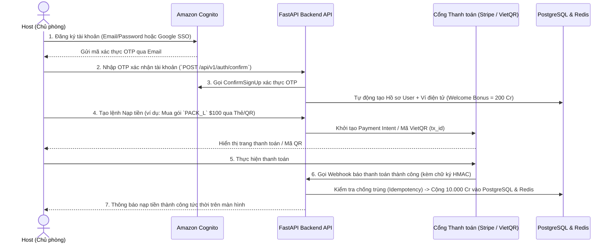
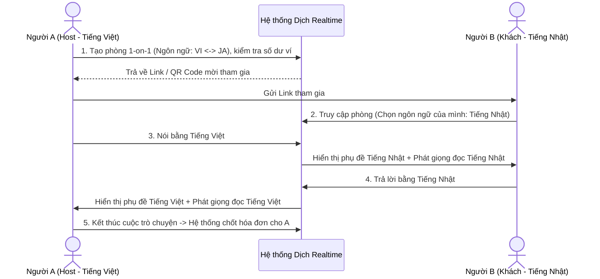
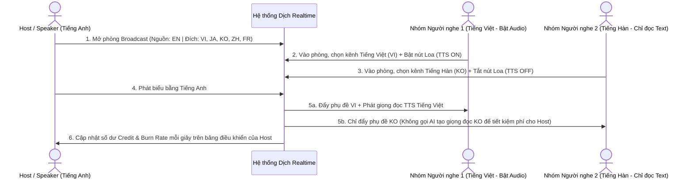

# Tài liệu Nghiệp vụ & Cơ chế Tính phí (Business Requirements & Pay-as-you-go Billing)

- **Mã tài liệu**: `DOC-01-BRD`
- **Phiên bản**: `2.1` (Hoàn thiện Unit Economics >= 55% Margin, Language/TTS Matrix `vi-VN`, Business KPIs, Non-Goals & Edge Cases vận hành)
- **Ngày cập nhật**: 2026-11-19
- **Tài liệu liên quan**:
  - [02-functional-specifications.md](file:///D:/code/ws-translation-realtime/docs/specs/02-functional-specifications.md)
  - [03-system-architecture-and-techstack.md](file:///D:/code/ws-translation-realtime/docs/specs/03-system-architecture-and-techstack.md)
  - [epics-and-sub-epics.md](file:///D:/code/ws-translation-realtime/docs/tasks/epics-and-sub-epics.md)

---

## 1. Bối cảnh & Mục tiêu Nghiệp vụ (Business Context & Goals)

Nền tảng cung cấp dịch vụ **Dịch thuật giọng nói theo thời gian thực (Realtime Speech-to-Text & Speech-to-Speech Translation)** phục vụ hai nhóm nhu cầu chính:
1. **Giao tiếp song phương (1-on-1 Bi-directional)**: Hai người bất đồng ngôn ngữ trò chuyện trực tiếp với nhau.
2. **Hội thảo / Sự kiện đa ngôn ngữ (1-to-Many Broadcast)**: Một diễn giả (Speaker) phát biểu bằng ngôn ngữ gốc và hàng trăm tới hàng nghìn thính giả (Listeners) tiếp nhận nội dung dịch sang ngôn ngữ của họ (dưới dạng phụ đề chữ chạy trực tiếp và giọng đọc AI) ngay lập tức.

### Chỉ số Mục tiêu Kỹ thuật & Sản phẩm (Technical SLA & Business KPIs):
- **Quy mô phòng tối đa**: Hỗ trợ từ `2` người (chế độ 1-1) đến `1.000` người nghe/phòng (chế độ Broadcast).
- **Số ngôn ngữ dịch đồng thời**: Tối đa `10` ngôn ngữ đích trong cùng một phiên phát sóng.
- **Độ trễ trải nghiệm (SLA)**: Phụ đề tạm thời (`Partial`) hiển thị `< 500ms`, phụ đề chốt câu (`Final`) `< 800ms`, giọng đọc dịch (`TTS Audio`) phát ngay sau khi dứt câu `< 1.2s`.
- **Độ sẵn sàng (Availability)**: Cam kết không ngắt kết nối phòng dịch của người nghe và không mất nội dung đang nói khi hệ thống tự động mở rộng/thu hẹp (Auto-scaling) hoặc khi một tiến trình xử lý gặp sự cố.
- **Chỉ số Kinh doanh (Product KPIs)**:
  - **Gross Margin mục tiêu**: `>= 55% – 65%` sau phí cổng thanh toán và hạ tầng cố định.
  - **Activation Rate**: `>= 40%` Host mới mở phòng dịch thành công đầu tiên trong 7 ngày sau đăng ký.
  - **Free-to-Paid Conversion**: `>= 8%` tài khoản `FREE` nâng lên gói trả phí hoặc mua Top-up trong 30 ngày.
  - **Monthly Retention (D30)**: `>= 75%` thuê bao trả phí gia hạn tháng tiếp theo.

### Phạm vi Ngoài Mục tiêu v1 (Non-Goals / Out of Scope):
- Chưa phát triển Native Mobile App (iOS/Android) — Người nghe sử dụng trình duyệt Web Mobile-first (`/r/[roomCode]`).
- Chưa hỗ trợ truyền tải Video / Screen-sharing (chỉ tập trung luồng âm thanh & phụ đề).
- Chưa xây dựng bot tự động tham gia Zoom / Google Meet / Microsoft Teams ở giai đoạn v1.
- Chưa hỗ trợ chế độ dịch Offline không có kết nối Internet.

---

## 2. Đối tượng Người dùng & Vai trò (User Roles & Actors)

| Vai trò (Actor) | Mô tả | Quyền hạn & Trách nhiệm chính |
| :--- | :--- | :--- |
| **Host (Chủ phòng / Tổ chức)** | Người dùng đã đăng ký tài khoản và nạp số dư (Credit/Wallet) trên hệ thống. | - Tạo phòng (`1-on-1` hoặc `Broadcast`). - Cấu hình ngôn ngữ nguồn, danh sách ngôn ngữ đích và quyền cho phép người nghe tải biên bản dịch (`allowListenerDownload`). - Là đối tượng chịu phí (**Billing Entity**) cho toàn bộ hoạt động của phòng. - Toàn quyền xem lại, tải xuống biên bản dịch đa định dạng (`.txt`, `.srt`, `.vtt`, `.csv`) và bấm kích hoạt **AI Tóm tắt Nội dung (AI Meeting Summary)** trong 90 ngày. - Cấp quyền nói (Speaker) hoặc đóng phòng. |
| **Speaker (Người nói / Diễn giả)** | Có thể chính là Host hoặc người được Host cấp quyền phát biểu trong phòng. | - Phát luồng âm thanh giọng nói trực tiếp vào phòng. - Trong chế độ `1-on-1`, cả 2 người tham gia đều đồng thời là Speaker và Listener. |
| **Listener (Người nghe / Thính giả)** | Người tham gia phòng hội thảo qua đường dẫn/mã phòng (không bắt buộc tạo tài khoản). | - Chọn 1 ngôn ngữ đích (trong danh sách Host đã mở) để xem phụ đề trực tiếp (bao gồm cả lịch sử các câu đã nói trước khi vào phòng). - Bật/tắt chế độ nghe giọng đọc dịch (Audio TTS) tùy nhu cầu. - Được phép tải xuống biên bản dịch và xem bản **AI Tóm tắt Nội dung** (nếu Host đã tạo và bật `allowListenerDownload = true`). - Không bị trừ phí cá nhân. |
| **System Admin (Quản trị viên)** | Nhân sự vận hành hệ thống. | - Cấu hình bảng đơn giá cước (Pricing Tier), theo dõi doanh thu, chi phí AWS COGS và giám sát chất lượng các phòng đang hoạt động. |

---

## 3. Các Kịch bản Nghiệp vụ Cốt lõi (Core Use Cases & User Flows)

### 3.1. Luồng Đăng ký Tài khoản, Xác thực (Cognito) & Nạp tiền vào Ví (Onboarding & Top-up Flow)

### 3.2. Chế độ Hội thoại 2 Chiều (1-on-1 Bi-directional Mode)

### 3.3. Chế độ Hội thảo Đa Ngôn Ngữ (Broadcast / Webinar Mode)

---

## 4. Quy tắc Nghiệp vụ Tối ưu Chi phí Tự động (Smart Cost-Optimization Rules)

Để bảo vệ lợi ích tài chính của Host trong mô hình Pay-as-you-go, hệ thống áp dụng 3 quy tắc tiết kiệm tự động:

1. **Quy tắc Lọc khoảng lặng (Voice Activity Detection - VAD)**:
   - Khi Speaker bật mic nhưng không nói (nghỉ giải lao, suy nghĩ quá 2 giây), hệ thống tự động tạm dừng gửi frame âm thanh rỗng sang dịch vụ nhận diện giọng nói, giúp Host không bị tính phí thời gian chết.
2. **Quy tắc Sinh giọng đọc theo Nhu cầu thực tế (Demand-Driven TTS)**:
   - Dù Host mở phòng cho phép 10 ngôn ngữ đích, hệ thống theo dõi theo thời gian thực xem ngôn ngữ nào đang có ít nhất `1` người nghe bật chế độ phát âm thanh (`TTS ON`).
   - Nếu ngôn ngữ `Pháp (fr-FR)` không có ai trong phòng chọn nghe giọng đọc (hoặc tất cả chỉ xem phụ đề chữ), hệ thống **không gọi dịch vụ tổng hợp giọng nói (Amazon Polly)** cho tiếng Pháp ở câu đó -> Giảm trực tiếp chi phí ký tự TTS cho Host.
3. **Quy tắc Gộp cụm dịch tạm thời (Partial Translation Throttling)**:
   - Khi người nói đang nói giữa câu, thay vì dịch lại toàn bộ câu sau mỗi 50ms, hệ thống gom cụm mỗi `300ms` (hoặc khi có thêm từ mới) mới gọi dịch tạm thời (`Partial`), giảm ~70% lượng ký tự thừa phát sinh trên dịch vụ dịch máy.

---

## 5. Mô hình Gói Dịch vụ, Ví Credit 3 Ngăn & Tính cước Theo Từng Giây (Plans, Credits & Per-Second Billing)

### 5.1. Đơn vị Credit, 4 Gói Subscription Cố định & Gói Top-up Lẻ
- **Đơn vị tính phí**: **Credit (`Cr`)** với tỷ lệ quy đổi chuẩn **`1 USD = 100 Credits`** (`1 Cr = $0.01`, lưu độ chính xác `0.01 Cr`).
- **Welcome Bonus tài khoản mới**: Tặng **`200 Credits`** (ngăn Promo, hạn 30 ngày) và gán mặc định gói `FREE` ngay khi xác thực OTP.
- **4 Gói Subscription cố định theo tháng** (quyết định quyền lợi `entitlements` và số Credit tặng mỗi chu kỳ):

| Gói | Giá / tháng | Credit tháng (`plan_credits`) | Bonus Top-up lẻ | Chế độ & Hạn mức chính | Tính năng nổi bật mở rộng theo gói |
| :--- | :---: | :---: | :---: | :--- | :--- |
| **FREE** | `$0` | `0 Cr` *(+200 Cr 1 lần)* | `+0%` | `1-on-1`, 1 ngôn ngữ, 2 người, 1 phòng đồng thời *(tối đa 15p/phòng)* | Phụ đề realtime, xem biên bản online 7 ngày |
| **PRO** | `$19` | `1.800 Cr` | `+5%` | `1-on-1` & `Broadcast`, 3 ngôn ngữ, 100 người, 1 phòng đồng thời | + TTS mặc định, Passcode, Lên lịch phòng (`Scheduled Room`), Lọc từ nhạy cảm (`Profanity Masking`), 2 bộ từ điển (50 từ), Export `.txt/.md` (30 ngày), AI Summary ngôn ngữ gốc, Auto Degrade TTS |
| **BUSINESS** | `$59` | `6.000 Cr` | `+10%` | `1-on-1` & `Broadcast`, 6 ngôn ngữ, 300 người, **3 phòng đồng thời** | + Chọn giọng TTS Nam/Nữ, tối đa 3 Speakers (Co-Host), Custom Logo/Màu phòng nghe, 10 bộ từ điển (256 từ), Export full `.txt/.md/.srt/.vtt/.csv` (90 ngày) + Listener Download, AI Summary đa ngôn ngữ, Session Analytics (CSV), Auto Top-up & Hóa đơn VAT |
| **ENTERPRISE** | `$199` | `21.000 Cr` | `+15%` | `1-on-1` & `Broadcast`, 10 ngôn ngữ, 1.000 người, **10 phòng đồng thời** | + Full White-label (ẩn watermark), tối đa 10 Speakers, Từ điển không giới hạn + Import CSV, lưu biên bản 365 ngày, Session Analytics PDF |

- **3 Gói Nạp Credit Lẻ cố định (`credit_packs` — Không hết hạn)**:
  - `PACK_S`: `$10` -> `1.000 Cr` (+ `% Bonus` theo gói đang sở hữu)
  - `PACK_M`: `$30` -> `3.000 Cr` (+ `% Bonus` theo gói đang sở hữu)
  - `PACK_L`: `$100` -> `10.000 Cr` (+ `% Bonus` theo gói đang sở hữu)
- **Quy tắc Nâng/Hạ gói, Grace Period & Gia hạn VietQR**:
  - **Upgrade**: Thanh toán giá cố định gói mới (Stripe hoặc VietQR) -> kích hoạt chu kỳ 30 ngày mới ngay lập tức, mở khóa `entitlements` và cấp trọn `plan_credits` gói mới.
  - **Downgrade / Hủy gia hạn**: Giữ quyền lợi đến hết chu kỳ hiện tại; khi hết kỳ chuyển về gói mới, `plan_credits` dư về `0`, **bảo toàn 100% `topup_credits`**.
  - **Stripe `PAST_DUE` Grace Period**: Nếu gia hạn thẻ thất bại, giữ quyền gói trong **3 ngày ân hạn** (gửi email cảnh báo + retry tự động); quá 3 ngày không thành công mới chuyển về `FREE`.
  - **Nhắc gia hạn VietQR**: Vì VietQR không tự thu tiền định kỳ, hệ thống gửi Email & In-app nhắc gia hạn trước **7 ngày, 3 ngày và 1 ngày** trước `current_period_end`.
- **Chống lạm dụng gói `FREE` (Anti-Abuse)**: Chặn domain email dùng một lần (disposable email blocklist), giới hạn đăng ký theo IP, giới hạn tối đa `15 phút/phòng` và `1` phòng đồng thời cho tài khoản `FREE`.

### 5.2. Luật 3 Ngăn Credit & Công thức Tính cước Theo Từng Giây (Per-Second Billing)
- **Đối tượng trả phí**: Duy nhất **Host** (chủ phòng).
- **3 ngăn Credit & Thứ tự trừ ưu tiên** (`total_credits = promo_credits + plan_credits + topup_credits`):
  1. `promo_credits` (Welcome Bonus, Voucher — có hạn dùng) -> trừ trước.
  2. `plan_credits` (Credit theo gói tháng — reset cuối chu kỳ) -> trừ thứ hai.
  3. `topup_credits` (Credit mua từ `PACK_S/M/L` hoặc Auto Top-up — không hết hạn) -> trừ sau cùng.
- **Tính cước chính xác từng giây thực tế (Không làm tròn block 10 giây)**:
  - Đo & trừ realtime mỗi **1 giây** trên Redis (`wallet:{hostId}:credits`, xử lý nguyên tử qua Lua script để hỗ trợ nhiều phòng chạy song song không bao giờ âm), flush nguyên tử xuống PostgreSQL (`wallets` + `usage_ledger`) định kỳ mỗi **15 giây** và **ngay lập tức** khi `PAUSE` / `END_ROOM` / `QUOTA_EXHAUSTED`.

$$\text{Credits} = \left(\frac{S_{\text{audio}}}{60} \times R_{\text{stt}}\right) + \left(\frac{C_{\text{mt}}}{1000} \times R_{\text{mt}}\right) + \left(\frac{C_{\text{tts}}}{1000} \times R_{\text{tts}}\right) + \left(\frac{S_{\text{listener}}}{6000} \times R_{\text{listener\_100/phút}}\right)$$

| Ký hiệu | Ý nghĩa | AWS COGS tham khảo | Đơn giá bán lẻ mặc định (Credits) |
| :--- | :--- | :--- | :--- |
| $S_{\text{audio}}$ | Số **giây thực tế** có tiếng nói (`vad_flag = 1`, bước `0.1s`) | `$0.024 / phút` | **`5.5 Cr / phút`** (Khoảng lặng = `0 Cr`, Margin ~56%) |
| $C_{\text{mt}}$ | Số ký tự dịch máy phát sinh | `$0.015 / 1k ký tự` | **`3.5 Cr / 1.000 ký tự`** (Margin ~57%) |
| $C_{\text{tts}}$ | Số ký tự tổng hợp giọng đọc Neural (`tts_count > 0`) | `$0.016 / 1k ký tự` | **`4.0 Cr / 1.000 ký tự`** (Margin ~60%) |
| $S_{\text{listener}}$ | Tổng **người-giây** kết nối thực tế | `~$0.002 / 100 người / phút` | **`0.5 Cr / 100 người / phút`** |
| $C_{\text{summary}}$ | Phí **AI Tóm tắt Nội dung** (On-Demand 1 lần/phòng) | `~$0.01 - $0.02 / phòng` | **`15 Cr`** (`PRO`) / **`25 Cr`** (`BUSINESS+`); xem lại từ cache = **`0 Cr`** |

> **Minh bạch chế độ `1-on-1` & Hiển thị Burn Rate**:
> - Trên giao diện, hệ thống quy đổi sang **Tốc độ tiêu thụ (`Burn Rate Cr/phút`)** và **Số phút còn lại ước tính** cập nhật từng giây.
> - Riêng chế độ **`1-on-1` Full-duplex** có **2 người nói đồng thời (2 luồng STT + MT)** -> UI phải hiển thị rõ Burn Rate tính cho cả 2 chiều nói (Host là người chịu toàn bộ chi phí phòng).

### 5.3. Quy trình Kiểm soát Hạn mức & Xử lý Cạn Credit (Quota Exhaustion Workflow)

| Ngưỡng số dư Credit (Tính theo Burn Rate hiện tại) | Trạng thái Hệ thống | Hành động Nghiệp vụ |
| :--- | :--- | :--- |
| **Trước khi mở phòng** | Kiểm tra điều kiện (`Pre-check`) | Kiểm tra `EntitlementGuard` theo gói + yêu cầu `total_credits` đủ cho **10 phút** ước tính. Không đủ -> Chặn mở phòng (`402`), gợi ý mua Top-up Pack. |
| **Còn đủ `< 5 phút`** | Cảnh báo sớm (`LOW_BALANCE_WARNING`) | Hiển thị banner cảnh báo riêng Host kèm popup mua nhanh `PACK_S/M/L` ngay trong phòng (In-room Quick Top-up). |
| **Còn đủ `< 1 phút`** | Hạ cấp mềm (`GRACEFUL_DEGRADATION`) | Nếu gói có quyền `allowAutoDegradeTts` và Host bật -> tự tắt TTS (chỉ giữ dịch phụ đề chữ) để kéo dài thời gian hội thảo. |
| **Số dư `= 0.00 Cr`** | Đóng phiên an toàn (`QUOTA_EXHAUSTED`) | Chốt câu dịch cuối đang xử lý, flush chính xác phần giây lẻ cuối cùng, đóng phòng an toàn và tổng hợp biên bản S3. |

### 5.4. Cơ chế Thanh toán, Tự động Nạp & 2 Sổ Lịch sử Tài chính

1. **Phương thức Thanh toán Hỗ trợ**:
   - **Quốc tế (Stripe)**: Hỗ trợ Subscription hàng tháng, mua gói Top-up `PACK_S/M/L` và lưu thẻ Tokenized phục vụ Auto Top-up (`BUSINESS+`).
   - **Nội địa (VietQR / VNPay / SePay)**: Sinh mã QR cố định theo giá gói Subscription (chu kỳ 30 ngày) hoặc Top-up Pack, khớp lệnh tự động qua Webhook `< 5 giây`.
2. **Nạp nhanh trong phòng & Auto Top-up**:
   - Cộng trực tiếp vào `topup_credits` (PostgreSQL + Redis) không làm gián đoạn luồng thu âm.
   - Auto Top-up (`BUSINESS+`): Khi `total_credits < auto_topup_threshold_credits`, tự động charge thẻ mua gói `auto_topup_pack_id` (kèm Redis lock chống trùng).
3. **Minh bạch với 2 Sổ Lịch sử tách biệt**:
   - **Lịch sử Nạp tiền & Mua gói (`payment_transactions`)**: Theo dõi mọi giao dịch Subscription, Top-up Pack (+ bonus), Promo Credit, Refund và tải hóa đơn PDF VAT.
   - **Lịch sử Sử dụng Credit (`credit_ledger` + Drill-down `usage_ledger`)**: Hiển thị gọn từng phiên phòng, AI Summary, Credit hết hạn (kèm chi tiết trừ từ ngăn `Promo / Plan / Top-up`) và cho phép bấm xem chi tiết bóc tách theo từng giây + xuất CSV.
4. **Đảm bảo Toàn vẹn Giao dịch (Idempotency)**: Mọi Webhook kiểm tra `HMAC-SHA256` và khóa dòng PostgreSQL theo `transaction_id` UNIQUE.

---

## 6. Yêu cầu Phi chức năng, Ngôn ngữ Hỗ trợ, Thông báo & Quyền riêng tư

1. **Tính minh bạch & Đối soát (Auditability)**:
   - Mọi cửa sổ flush theo từng giây đều lưu vết bất biến vào `usage_ledger` và tổng hợp từng phiên vào `credit_ledger` (kèm `deducted_breakdown` 3 ngăn `Promo / Plan / Top-up`) để Host đối soát & xuất báo cáo CSV/PDF.
2. **Không tính phí khi lỗi hệ thống**:
   - Nếu xảy ra lỗi `5xx` từ phía dịch vụ AI (Transcribe / Translate / TTS), các frame âm thanh/ký tự bị lỗi đó **tuyệt đối không được cộng vào bộ đếm trừ Credit** (`0 Cr`).
3. **Ma trận Ngôn ngữ Hỗ trợ & Chiến lược TTS Tiếng Việt (`Language Support Matrix`)**:
   - **STT (Amazon Transcribe Streaming) & MT (Amazon Translate)**: Hỗ trợ đầy đủ nhóm ngôn ngữ chủ lực (`vi-VN`, `en-US`, `en-GB`, `ja-JP`, `ko-KR`, `zh-CN`, `fr-FR`, `de-DE`, `es-ES`, `th-TH`, `id-ID`).
   - **TTS (Multi-Provider Adapter — đồng giá `$16 / 1M ký tự`)**:
     - **Primary (Amazon Polly Neural)**: `en-US`, `en-GB`, `ja-JP`, `ko-KR`, `zh-CN`, `fr-FR`, `de-DE`, `es-ES`.
     - **Azure AI Speech Neural (`southeastasia` Singapore, `< 5ms` RTT từ AWS `ap-southeast-1`)**: Phục vụ các ngôn ngữ Amazon Polly chưa hỗ trợ giọng đọc gồm **Tiếng Việt (`vi-VN`: `vi-VN-HoaiMyNeural` Nữ / `vi-VN-NamMinhNeural` Nam)**, Tiếng Thái (`th-TH`), Tiếng Indonesia (`id-ID`). Nếu lỗi `5xx`/timeout hoặc chưa cấu hình key, hệ thống không trừ Credit (`0 Cr`) và tự hạ về chế độ `Text-only` gắn nhãn rõ trên giao diện Người nghe.
4. **Chính sách Lưu trữ Biên bản & Xử lý khi Downgrade (Retention Policy)**:
   - **File âm thanh TTS (`.mp3`/`.ogg`)**: Lưu tạm trên S3 và tự động xóa sau **24 giờ**.
   - **Biên bản Bản dịch & AI Summary trên S3**: Lưu theo gói tại thời điểm kết thúc phòng (`FREE`: 7 ngày, `PRO`: 30 ngày, `BUSINESS`: 90 ngày, `ENTERPRISE`: 365 ngày) dựa trên cột `room_transcripts.expires_at`. Khi Host hạ gói, các biên bản cũ **không bị xóa đột ngột** và được cấp **14 ngày ân hạn** để tải về.
   - **Phân quyền tải xuống**: Host luôn được tải theo `exportFormats` của gói; Listener chỉ được tải nếu Host thuộc gói `BUSINESS+` và bật `allowListenerDownload = true`.
5. **Ma trận Thông báo Nghiệp vụ (Notification Matrix — Amazon SES & In-App)**:
   - Gửi thông báo tự động cho 8 sự kiện: (1) OTP/Reset mật khẩu, (2) Thanh toán gói/Top-up thành công kèm PDF, (3) Nhắc gia hạn VietQR trước `7 / 3 / 1 ngày`, (4) Gia hạn Stripe lỗi (`PAST_DUE` — Grace Period 3 ngày), (5) Auto Top-up lỗi thẻ, (6) Promo Credit sắp hết hạn trước `3 ngày`, (7) Biên bản S3 sẵn sàng, (8) AI Summary sẵn sàng.
6. **Quyền riêng tư, Thông báo Thu âm & Xóa dữ liệu (Privacy & GDPR/PDPA)**:
   - Màn hình Người nghe (`SCR-04`) và khách `1-on-1` luôn hiển thị banner minh bạch *"Phiên này đang được phiên dịch & lưu biên bản AI"*.
   - Host có quyền chủ động xóa biên bản của từng phòng (`DELETE /api/v1/rooms/{id}/transcripts`) hoặc yêu cầu xóa toàn bộ tài khoản & dữ liệu cá nhân (`DELETE /api/v1/users/me`).
