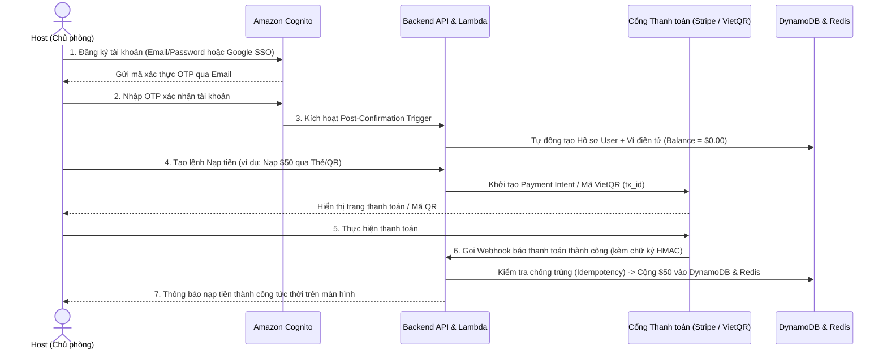
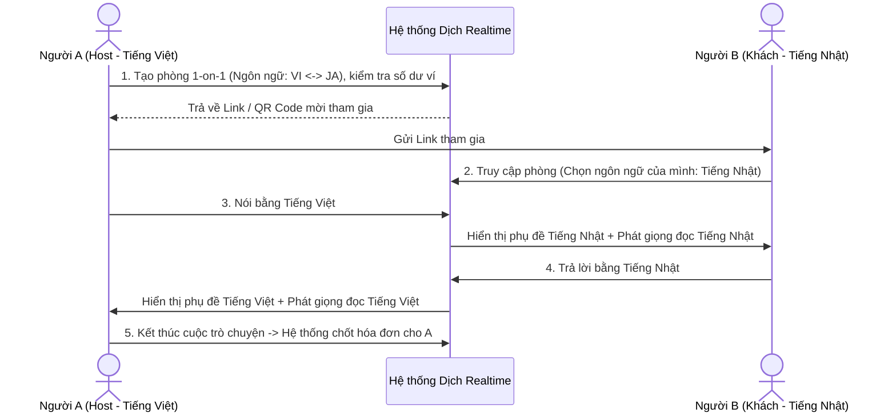
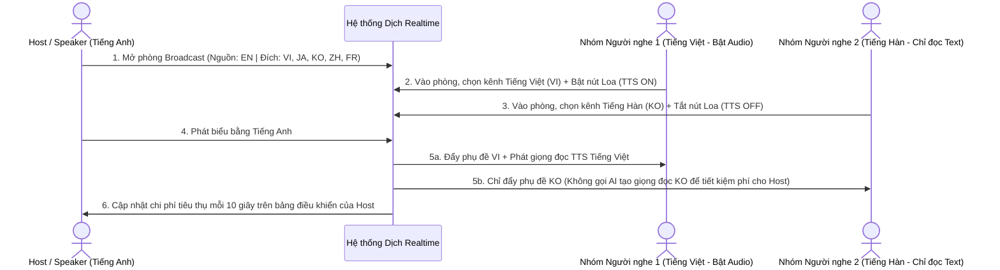

# Tài liệu Nghiệp vụ & Cơ chế Tính phí (Business Requirements & Pay-as-you-go Billing)

- **Mã tài liệu**: `DOC-01-BRD`
- **Phiên bản**: `1.0`
- **Ngày cập nhật**: 2026-11-09
- **Tài liệu liên quan**:
  - [02-functional-specifications.md](file:///D:/code/ws-translation-realtime/docs/specs/02-functional-specifications.md)
  - [03-system-architecture-and-techstack.md](file:///D:/code/ws-translation-realtime/docs/specs/03-system-architecture-and-techstack.md)

---

## 1. Bối cảnh & Mục tiêu Nghiệp vụ (Business Context & Goals)

Nền tảng cung cấp dịch vụ **Dịch thuật giọng nói theo thời gian thực (Realtime Speech-to-Text & Speech-to-Speech Translation)** phục vụ hai nhóm nhu cầu chính:
1. **Giao tiếp song phương (1-on-1 Bi-directional)**: Hai người bất đồng ngôn ngữ trò chuyện trực tiếp với nhau.
2. **Hội thảo / Sự kiện đa ngôn ngữ (1-to-Many Broadcast)**: Một diễn giả (Speaker) phát biểu bằng ngôn ngữ gốc và hàng trăm tới hàng nghìn thính giả (Listeners) tiếp nhận nội dung dịch sang ngôn ngữ của họ (dưới dạng phụ đề chữ chạy trực tiếp và giọng đọc AI) ngay lập tức.

### Chỉ số Mục tiêu Nghiệp vụ (Business KPIs & SLA):
- **Quy mô phòng tối đa**: Hỗ trợ từ `2` người (chế độ 1-1) đến `1.000` người nghe/phòng (chế độ Broadcast).
- **Số ngôn ngữ dịch đồng thời**: Tối đa `10` ngôn ngữ đích trong cùng một phiên phát sóng.
- **Độ trễ trải nghiệm**: Phụ đề tạm thời (`Partial`) hiển thị `< 500ms`, phụ đề chốt câu (`Final`) `< 800ms`, giọng đọc dịch (`TTS Audio`) phát ngay sau khi dứt câu `< 1.2s`.
- **Độ sẵn sàng (Availability)**: Cam kết không ngắt kết nối phòng dịch của người nghe và không mất nội dung đang nói khi hệ thống tự động mở rộng/thu hẹp (Auto-scaling) hoặc khi một tiến trình xử lý gặp sự cố.

---

## 2. Đối tượng Người dùng & Vai trò (User Roles & Actors)

| Vai trò (Actor) | Mô tả | Quyền hạn & Trách nhiệm chính |
| :--- | :--- | :--- |
| **Host (Chủ phòng / Tổ chức)** | Người dùng đã đăng ký tài khoản và nạp số dư (Credit/Wallet) trên hệ thống. | - Tạo phòng (`1-on-1` hoặc `Broadcast`). - Cấu hình ngôn ngữ nguồn, danh sách ngôn ngữ đích và quyền cho phép người nghe tải biên bản dịch (`allowListenerDownload`). - Là đối tượng chịu phí (**Billing Entity**) cho toàn bộ hoạt động của phòng. - Toàn quyền xem lại, tải xuống biên bản dịch đa định dạng (`.txt`, `.srt`, `.vtt`, `.csv`) và bấm kích hoạt **AI Tóm tắt Nội dung (AI Meeting Summary)** trong 90 ngày. - Cấp quyền nói (Speaker) hoặc đóng phòng. |
| **Speaker (Người nói / Diễn giả)** | Có thể chính là Host hoặc người được Host cấp quyền phát biểu trong phòng. | - Phát luồng âm thanh giọng nói trực tiếp vào phòng. - Trong chế độ `1-on-1`, cả 2 người tham gia đều đồng thời là Speaker và Listener. |
| **Listener (Người nghe / Thính giả)** | Người tham gia phòng hội thảo qua đường dẫn/mã phòng (không bắt buộc tạo tài khoản). | - Chọn 1 ngôn ngữ đích (trong danh sách Host đã mở) để xem phụ đề trực tiếp (bao gồm cả lịch sử các câu đã nói trước khi vào phòng). - Bật/tắt chế độ nghe giọng đọc dịch (Audio TTS) tùy nhu cầu. - Được phép tải xuống biên bản dịch và xem bản **AI Tóm tắt Nội dung** (nếu Host đã tạo và bật `allowListenerDownload = true`). - Không bị trừ phí cá nhân. |
| **System Admin (Quản trị viên)** | Nhân sự vận hành hệ thống. | - Cấu hình bảng đơn giá cước (Pricing Tier), theo dõi doanh thu, chi phí AWS COGS và giám sát chất lượng các phòng đang hoạt động. |

---

## 3. Các Kịch bản Nghiệp vụ Cốt lõi (Core Use Cases & User Flows)

### 3.1. Luồng Đăng ký Tài khoản, Xác thực (Cognito) & Nạp tiền vào Ví (Onboarding & Top-up Flow)

### 3.2. Chế độ Hội thoại 2 Chiều (1-on-1 Bi-directional Mode)

### 3.3. Chế độ Hội thảo Đa Ngôn Ngữ (Broadcast / Webinar Mode)

---

## 4. Quy tắc Nghiệp vụ Tối ưu Chi phí Tự động (Smart Cost-Optimization Rules)

Để bảo vệ lợi ích tài chính của Host trong mô hình Pay-as-you-go, hệ thống áp dụng 3 quy tắc tiết kiệm tự động:

1. **Quy tắc Lọc khoảng lặng (Voice Activity Detection - VAD)**:
   - Khi Speaker bật mic nhưng không nói (nghỉ giải lao, suy nghĩ quá 2 giây), hệ thống tự động tạm dừng gửi frame âm thanh rỗng sang dịch vụ nhận diện giọng nói, giúp Host không bị tính phí thời gian chết.
2. **Quy tắc Sinh giọng đọc theo Nhu cầu thực tế (Demand-Driven TTS)**:
   - Dù Host mở phòng cho phép 10 ngôn ngữ đích, hệ thống theo dõi theo thời gian thực xem ngôn ngữ nào đang có ít nhất `1` người nghe bật chế độ phát âm thanh (`TTS ON`).
   - Nếu ngôn ngữ `Pháp (fr-FR)` không có ai trong phòng chọn nghe giọng đọc (hoặc tất cả chỉ xem phụ đề chữ), hệ thống **không gọi dịch vụ tổng hợp giọng nói (Amazon Polly)** cho tiếng Pháp ở câu đó -> Giảm trực tiếp chi phí ký tự TTS cho Host.
3. **Quy tắc Gộp cụm dịch tạm thời (Partial Translation Throttling)**:
   - Khi người nói đang nói giữa câu, thay vì dịch lại toàn bộ câu sau mỗi 50ms, hệ thống gom cụm mỗi `300ms` (hoặc khi có thêm từ mới) mới gọi dịch tạm thời (`Partial`), giảm ~70% lượng ký tự thừa phát sinh trên dịch vụ dịch máy.

---

## 5. Mô hình Tính phí Pay-as-you-go (Metering & Billing Specification)

### 5.1. Nguyên tắc Ghi nhận và Trừ cước
- **Đối tượng trả phí**: Duy nhất **Host** (chủ phòng).
- **Chu kỳ chốt cước vi mô (Micro-billing Cycle)**: Mỗi **10 giây** một lần trong suốt thời gian phòng đang ở trạng thái `ACTIVE`.
- **Đơn vị đo lường gốc (Raw Metering Metrics)**:
  1. `audio_input_seconds`: Tổng số giây âm thanh có giọng nói thực tế từ Speaker.
  2. `translated_chars`: Tổng số ký tự được dịch sang các ngôn ngữ đích (bao gồm cả Partial và Final).
  3. `tts_chars`: Tổng số ký tự được chuyển thành giọng nói ở các ngôn ngữ có người nghe bật Audio.
  4. `listener_connection_minutes`: Tổng số phút kết nối của toàn bộ người nghe trong phòng (quy đổi từ tổng số người nghe đang online trong mỗi chu kỳ 10 giây).

### 5.2. Công thức Tính phí cho Host

Trong mỗi chu kỳ 10 giây ($t$), số tiền khấu trừ vào ví của Host ($\Delta \text{Cost}_t$) được tính bằng công thức:

$$\Delta \text{Cost}_t = \left( S_{\text{audio}} \times P_{\text{stt}} \right) + \left( C_{\text{mt}} \times P_{\text{mt}} \right) + \left( C_{\text{tts}} \times P_{\text{tts}} \right) + \left( N_{\text{listeners}} \times \frac{10}{60} \times P_{\text{listener\_min}} \right)$$

| Ký hiệu | Ý nghĩa | Đơn giá AWS COGS tham khảo (Giá vốn) | Gợi ý Đơn giá bán lẻ (Retail Price) |
| :--- | :--- | :--- | :--- |
| $S_{\text{audio}}$ | Số giây âm thanh đầu vào trong 10s | $\$0.00040 / \text{giây}$ ($\$0.024/\text{phút}$) | Cấu hình theo gói cước hệ thống |
| $C_{\text{mt}}$ | Số ký tự dịch máy phát sinh trong 10s | $\$0.000015 / \text{ký tự}$ ($\$15 / 1\text{M ký tự}$) | Cấu hình theo gói cước hệ thống |
| $C_{\text{tts}}$ | Số ký tự tổng hợp giọng đọc Neural trong 10s | $\$0.000016 / \text{ký tự}$ ($\$16 / 1\text{M ký tự}$) | Cấu hình theo gói cước hệ thống |
| $N_{\text{listeners}}$ | Số lượng người nghe đồng thời trong phòng | $\approx \$0.00002 / \text{người/phút}$ (AppSync + CDN) | Cấu hình theo bậc thang mỗi 100 người |
| $C_{\text{summary}}$ | Phí **AI Tóm tắt Nội dung** (On-Demand 1 lần/phòng) | $\approx \$0.005 - \$0.02 / \text{buổi họp}$ (Amazon Bedrock) | Chỉ trừ 1 lần duy nhất khi Host bấm nút *"Tóm tắt AI"*; các lần xem lại sau hoàn toàn miễn phí (`$0`) |

> **Chế độ Hiển thị Đơn giản hóa cho Host**: Trên giao diện người dùng, hệ thống quy đổi công thức trên thành **"Chi phí ước tính mỗi phút (Burn Rate $/phút)"** dựa trên cấu hình hiện tại của phòng để Host dễ theo dõi (ví dụ: *"Phòng đang mở 5 ngôn ngữ, 350 người nghe — Tốc độ tiêu thụ: $0.18/phút"*).

### 5.3. Quy trình Kiểm soát Hạn mức & Xử lý Cạn ví (Quota Exhaustion Workflow)

| Ngưỡng số dư ví (Tính theo Burn Rate hiện tại) | Trạng thái Hệ thống | Hành động Nghiệp vụ |
| :--- | :--- | :--- |
| **Trước khi mở phòng** | Kiểm tra điều kiện (`Pre-check`) | Yêu cầu số dư tối thiểu đủ cho **10 phút** hoạt động theo cấu hình ngôn ngữ đã chọn. Nếu không đủ -> Chặn mở phòng, yêu cầu nạp thêm. |
| **Còn đủ `< 5 phút`** | Cảnh báo sớm (`LOW_BALANCE_WARNING`) | Hiển thị banner cảnh báo cho riêng Host kèm nút nạp nhanh (Top-up) hoặc gợi ý tắt bớt ngôn ngữ không cần thiết. Người nghe không nhìn thấy cảnh báo này. |
| **Còn đủ `< 1 phút`** | Hạ cấp mềm (`GRACEFUL_DEGRADATION`) | Nếu Host bật cấu hình *"Tự động tiết kiệm khi sắp hết tiền"*, hệ thống tự động tắt tính năng phát giọng đọc TTS (chỉ giữ lại dịch phụ đề chữ) để kéo dài thời gian hội thảo thêm ~40%. |
| **Số dư `= $0.00`** | Đóng phiên an toàn (`QUOTA_EXHAUSTED`) | Chốt câu dịch cuối cùng đang xử lý, gửi thông báo kết thúc phiên lịch sự tới toàn bộ người nghe, đóng phòng và xuất hóa đơn chi tiết cho Host. |

### 5.4. Cơ chế Nạp tiền, Thanh toán & Tự động Nạp (Top-up & Payment Handling)

1. **Phương thức Thanh toán Hỗ trợ**:
   - **Quốc tế (Stripe)**: Hỗ trợ thẻ Visa, Mastercard, American Express, Apple Pay, Google Pay (hỗ trợ lưu thẻ Tokenized phục vụ Auto Top-up).
   - **Nội địa (VietQR / VNPay / SePay)**: Sinh mã QR chuyển khoản ngân hàng tự động chứa nội dung định danh giao dịch (`tx_id`), tự động khớp lệnh qua Webhook trong `< 5 giây` sau khi chuyển khoản.
2. **Nạp tiền Trực tiếp Ngay Trong Phòng (In-Room Live Top-up)**:
   - Khi đang diễn ra hội thảo mà nhận cảnh báo sắp hết tiền (`< 5 phút`), Host có thể bấm nút **"Nạp nhanh"** ngay trên thanh điều khiển hoặc quét mã QR trên điện thoại mà không làm gián đoạn luồng thu âm.
   - Ngay khi Webhook thanh toán báo thành công, hệ thống cộng thẳng số tiền mới vào cả **DynamoDB** và bộ nhớ đệm **Redis (`wallet:{hostId}:balance`)** để kéo dài thời gian phòng tức thì.
3. **Tự động Nạp tiền khi Chạm ngưỡng (Auto Top-up)**:
   - Host có thể liên kết thẻ thanh toán và bật cấu hình: *"Tự động nạp thêm `$20` khi số dư khả dụng xuống dưới `$5`"*.
   - Tiến trình Billing khi phát hiện số dư sau khấu trừ xuống dưới `$5` sẽ tự động kích hoạt giao dịch thu tiền ngầm (Off-session Charge) để hội thảo không bao giờ bị ngắt giữa chừng.
4. **Đảm bảo Toàn vẹn Giao dịch (Idempotency & Reconciliation)**:
   - Mọi Webhook từ cổng thanh toán đều được kiểm tra chữ ký điện tử (`HMAC-SHA256`) và khóa chống trùng lặp theo `tx_id` (đảm bảo nếu cổng thanh toán gọi lại Webhook nhiều lần do lỗi mạng thì ví của Host chỉ được cộng tiền đúng 1 lần duy nhất).

---

## 6. Yêu cầu Phi chức năng về Nghiệp vụ (Business Non-Functional Requirements)

1. **Tính minh bạch & Đối soát (Auditability)**:
   - Mọi chu kỳ trừ tiền 10 giây đều phải lưu vết vào sổ cái (`Usage Ledger`) kèm thông tin chi tiết: Mã phòng, thời gian, số giây nói, số ký tự từng ngôn ngữ, số người nghe để Host có thể tải báo cáo CSV/PDF sau buổi hội thảo.
2. **Không tính phí khi lỗi hệ thống**:
   - Nếu xảy ra lỗi từ phía dịch vụ AI của AWS (ví dụ: Transcribe hoặc Translate trả về lỗi 5xx), các frame âm thanh/ký tự bị lỗi đó **tuyệt đối không được cộng vào bộ đếm tính phí** của Host.
3. **Bảo mật nội dung & Chính sách Lưu trữ Biên bản Hội thảo (Retention Policy)**:
   - **File âm thanh (Audio Chunks)**: Các đoạn ghi âm tạm thời và file âm thanh TTS (`.mp3`/`.ogg`) chỉ phục vụ phát trực tiếp và tự động xóa hoàn toàn khỏi S3 sau **24 giờ**.
   - **Lịch sử & Biên bản Bản dịch (Transcripts)**:
     - **Lưu trữ nóng (24 giờ trên DynamoDB)**: Phục vụ người nghe vào phòng muộn hoặc tải lại trang (F5) có thể xem ngay toàn bộ lịch sử phụ đề từ đầu buổi họp; tự động xóa khỏi DynamoDB sau **24 giờ** qua cơ chế TTL.
     - **Lưu trữ tổng hợp (90 ngày trên Amazon S3 — Miễn phí cho Host)**: Ngay khi kết thúc phòng, hệ thống tự động tổng hợp toàn bộ bản dịch thành bộ file chuẩn (`.txt`, `.srt`, `.vtt`, `.csv`, `.json`) lưu trên S3 trong **90 ngày** (sau 90 ngày S3 Lifecycle tự động xóa vĩnh viễn).
     - **Phân quyền tải xuống**: Host luôn có toàn quyền tải xuống từ Dashboard; Listener chỉ được tải nếu Host bật tùy chọn `allowListenerDownload = true` cho phòng đó.
