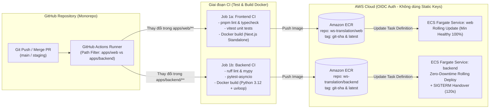

# Thiết kế Kiến trúc Hệ thống, HA/Zero-Downtime & Tech Stack (System Architecture & Technical Design)

- **Mã tài liệu**: `DOC-03-SAD`
- **Phiên bản**: `1.0`
- **Ngày cập nhật**: 2026-11-09
- **Tài liệu liên quan**:
  - [01-business-requirements-and-billing.md](file:///D:/code/ws-translation-realtime/docs/specs/01-business-requirements-and-billing.md)
  - [02-functional-specifications.md](file:///D:/code/ws-translation-realtime/docs/specs/02-functional-specifications.md)

---

## 1. Kiến trúc Tổng thể trên AWS (Single-AZ Optimized Architecture)

### 1.1. Nguyên lý Thiết kế Cốt lõi
1. **Tách biệt hoàn toàn tầng Ingest (Nhận âm thanh) và tầng Fan-out (Phát kết quả)**:
   - **Tầng Ingest & AI Orchestration**: Sử dụng cụm container **Amazon ECS Fargate** (State-recoverable qua Redis) để duy trì kết nối gRPC/HTTP2 streaming liên tục với các dịch vụ AI của AWS.
   - **Tầng Fan-out (1.000 người nghe/phòng)**: Sử dụng hoàn toàn dịch vụ Serverless **AWS AppSync Events** (cho phụ đề JSON realtime) kết hợp **Amazon CloudFront + S3** (cho các đoạn âm thanh TTS). Nhờ đó, kết nối của 1.000 người nghe không bao giờ bị ảnh hưởng khi tầng Compute phía sau co giãn hoặc gặp sự cố.
2. **Triển khai Single-AZ (1 Availability Zone) tối ưu chi phí và độ trễ**:
   - Toàn bộ các thành phần Compute & In-memory State trong VPC (**ECS Fargate Tasks** và **ElastiCache Redis**) được đặt chung trong **1 Availability Zone duy nhất** (ví dụ: `ap-southeast-1a`).
   - Triệt tiêu **100% chi phí băng thông chéo AZ (Cross-AZ Data Transfer = $0)** khi Worker liên tục ghi/đọc Audio Ring Buffer trên Redis, đồng thời đạt độ trễ mạng nội bộ `< 1ms`.
   - Tính sẵn sàng cao (HA) trong 1 AZ được đảm bảo bằng cách luôn duy trì tối thiểu **2 ECS Fargate Tasks** chạy độc lập cùng chia sẻ trạng thái qua Redis.

### 1.2. Sơ đồ Kiến trúc Hệ thống Chi tiết

```mermaid
flowchart TB
    subgraph Clients["Tầng Client (Web / Mobile SDK)"]
        Speaker["🎤 Speaker Client\n(Opus/PCM 16kHz + SeqID)\nLocal Ring Buffer (5s)"]
        Listeners["🎧 1..1.000 Listener Clients\n(AppSync WebSocket Subscriber)\nAdaptive Audio Queue"]
    end

    subgraph Edge_Serverless["Tầng AWS Edge & Serverless Fan-out"]
        ALB["AWS Application Load Balancer (AZ-a)\n- /* -> ECS Web (Next.js)\n- /api/* & /ws/* -> ECS Backend (FastAPI)"]
        AppSync["AWS AppSync Events\n(Serverless WebSocket Pub/Sub)\nTopic: rooms/{id}/lang/{code}"]
        CDN["Amazon CloudFront + S3\n(TTS Audio 24h & Transcript Exports 90d)"]
    end

    subgraph VPC_SingleAZ["AWS VPC — Single Availability Zone (ap-southeast-1a)"]
        subgraph ECS_Cluster["Amazon ECS Fargate Cluster (Single-AZ)"]
            WebService["ECS Service: web (Next.js 15 Docker)\nAuto-Scaling: 2..6 Tasks"]
            subgraph BackendService["ECS Service: backend (Python 3.12 FastAPI + uvloop Docker)\nAuto-Scaling: 2..20 Tasks (REST API + WS Ingest + Async Workers)"]
                Task1["FastAPI Task #1"]
                Task2["FastAPI Task #2"]
            end
        end
        Redis[("Amazon ElastiCache for Redis\n(Single-AZ Node)\n- Audio Ring Buffer (10s)\n- Active TTS Listeners Counter\n- Host Wallet Balance")]
    end

    subgraph AWS_AI["Tầng AWS Native AI Pipeline"]
        Transcribe["Amazon Transcribe Streaming\n(HTTP/2 Bi-directional Stream)"]
        Translate["Amazon Translate\n(Parallel N-Language MT)"]
        Polly["Amazon Polly Neural\n(Demand-Driven TTS)"]
        Bedrock["Amazon Bedrock\n(Claude 3.5 Haiku / Nova Lite)\nOn-Demand AI Meeting Summary"]
    end

    subgraph Data_Storage["Tầng Persistent Data & Auth"]
        Cognito["Amazon Cognito\n(Host User Pool)"]
        DynamoDB[("Amazon DynamoDB (On-Demand)\nUsers, Wallets, Payments,\nRooms, RoomTranscripts, UsageLedger")]
    end

    %% Luồng Ingest & Web
    Speaker == "1. HTTPS / WSS (/api, /ws)" ==> ALB
    Listeners -. "HTTPS (UI & REST /api)" .-> ALB
    ALB --> WebService
    ALB ==> Task1
    ALB -. "Hot Failover / Load Share" .-> Task2
    Task1 <-->|"XADD / XRANGE (<1ms)"| Redis
    Task2 <-->|"XADD / XRANGE (<1ms)"| Redis

    %% Luồng AI
    Task1 == "2. PCM Stream" ==> Transcribe
    Transcribe == "3. Partial/Final Text" ==> Task1
    Task1 == "4. Translate N Langs" ==> Translate
    Task1 == "5. Synthesize Speech" ==> Polly
    Task1 -- "6a. PutObject (.mp3 / Exports)" --> CDN
    Task1 -. "6c. Async Put Final Segment / Billing" .-> DynamoDB
    Task1 -. "7. Generate AI Summary" .-> Bedrock

    %% Luồng Fan-out
    Task1 == "6b. Publish JSON Event" ==> AppSync
    AppSync == "8a. Push Subtitle (<50ms)" ==> Listeners
    CDN == "8b. Fetch Audio / Transcript" ==> Listeners
```



---

## 2. Thiết kế Cơ chế HA, Auto-Scaling & Zero-Downtime

### 2.1. Kịch bản 1: Container xử lý âm thanh bị sập đột ngột (Crash / OOM Failover)
Khi `ECS Task #1` đang xử lý câu nói dở dang của Speaker mà bị crash:
1. **Phát hiện nhanh (`< 300ms`)**: Giao thức WebSocket giữa Speaker Client và ECS Task sử dụng cơ chế xác nhận `ACK` mỗi 500ms. Khi socket đóng hoặc quá `300ms` không nhận được `ACK`, Speaker Client lập tức mở kết nối mới qua ALB kèm theo tham số `room_id` và `last_sent_seq`.
2. **Tiếp quản & Khôi phục từ Redis Ring Buffer**:
   - ALB định tuyến kết nối mới vào `ECS Task #2` (đang chạy sẵn trong cùng `AZ-a`).
   - `ECS Task #2` truy vấn Redis key `room:{id}:state` để lấy `last_committed_seq` (số thứ tự frame cuối cùng của câu `Final` trước đó).
   - `ECS Task #2` đọc toàn bộ các frame âm thanh từ `last_committed_seq + 1` đến hiện tại từ Redis Stream `room:{id}:audio_buffer` và bơm tốc độ cao (Fast-replay) vào phiên **Amazon Transcribe Streaming** mới mở, sau đó ghép nối liền mạch với các frame mới từ Speaker Client gửi lên.
   - **Kết quả**: Câu đang nói dở vẫn được nhận diện và dịch trọn vẹn, không mất chữ nào; 1.000 người nghe trên AppSync Events không hề bị ngắt kết nối.

### 2.2. Kịch bản 2: Thu hẹp hệ thống (Scale-In) hoặc Cập nhật phần mềm (Rolling Deploy)
Để đảm bảo **0ms gián đoạn** khi tắt một container chủ động:
1. **ECS Task Scale-in Protection**: Các Task đang có `active_speaker_streams > 0` tự động gọi API `UpdateTaskProtection(protectionEnabled=true)` để hệ thống Auto Scaling chỉ tắt các Task đang rảnh rỗi.
2. **Giao thức Chuyển giao Chủ động (Make-Before-Break Handover)**:
   - Khi một Task bắt buộc phải dừng (nhận tín hiệu `SIGTERM` khi deploy phiên bản mới, với thời gian chờ `stopTimeout = 120s`), Task đánh dấu trạng thái `DRAINING`.
   - Ngay khi người nói vừa kết thúc câu hiện tại (`Transcribe IsPartial == false`), Task gửi gói tin điều khiển `{"event": "PREPARE_HANDOVER"}` về cho Speaker Client.
   - Speaker Client giữ nguyên kết nối cũ (`Conn A`), đồng thời mở kết nối mới (`Conn B`) tới một Task khỏe mạnh khác trên ALB.
   - Khi `Conn B` trả về tín hiệu `{"event": "HANDOVER_READY"}`, Speaker Client bắt đầu gửi frame âm thanh tiếp theo (`seq_id + 1`) qua `Conn B` và đóng `Conn A`.

### 2.3. Cấu hình Auto-Scaling cho ECS Fargate
- **Kích thước mỗi Task**: `1 vCPU`, `2 GB Memory` (hỗ trợ tối đa `30` luồng Speaker đồng thời/Task).
- **Min Capacity**: `2 Tasks` (luôn chạy trong `AZ-a` để sẵn sàng Failover).
- **Max Capacity**: `20 Tasks` (hỗ trợ tới `600` phòng hội thảo đồng thời).
- **Quy tắc Scale Out**: Thêm `+2 Tasks` ngay khi `Average ActiveStreamsPerTask >= 20` hoặc `CPU Utilization >= 60%` trong 60 giây.
- **Quy tắc Scale In**: Giảm `-1 Task` khi `Average ActiveStreamsPerTask <= 5` liên tục trong 10 phút.

---

## 3. Thiết kế Giao thức & Cấu trúc Dữ liệu (Data Structures & Schemas)

### 3.1. Giao thức Khung Âm thanh Nhị phân (WebSocket Binary Audio Frame)
Speaker Client gửi các frame âm thanh mỗi `100ms` (PCM 16kHz, 16-bit, Mono = `3.200 bytes` hoặc Opus `~400 bytes`) theo cấu trúc:

```text
 0                   1                   2                   3
 0 1 2 3 4 5 6 7 8 9 0 1 2 3 4 5 6 7 8 9 0 1 2 3 4 5 6 7 8 9 0 1
+-+-+-+-+-+-+-+-+-+-+-+-+-+-+-+-+-+-+-+-+-+-+-+-+-+-+-+-+-+-+-+-+
|                        seq_id (UInt32)                        |
+-+-+-+-+-+-+-+-+-+-+-+-+-+-+-+-+-+-+-+-+-+-+-+-+-+-+-+-+-+-+-+-+
|                                                               |
+                     timestamp_ms (UInt64)                     +
|                                                               |
+-+-+-+-+-+-+-+-+-+-+-+-+-+-+-+-+-+-+-+-+-+-+-+-+-+-+-+-+-+-+-+-+
|  codec (UInt8)|  flags (UInt8)|        reserved (UInt16)      |
+-+-+-+-+-+-+-+-+-+-+-+-+-+-+-+-+-+-+-+-+-+-+-+-+-+-+-+-+-+-+-+-+
|                    Audio Payload (Variable)                   |
|                         (PCM / Opus)                          |
+-+-+-+-+-+-+-+-+-+-+-+-+-+-+-+-+-+-+-+-+-+-+-+-+-+-+-+-+-+-+-+-+
```
- `codec`: `1` = PCM 16kHz 16-bit Mono, `2` = Opus 16kHz.
- `flags`: Bit `0` = `is_speech` (kết quả từ VAD tại client), Bit `1` = `end_of_turn`.

### 3.2. Thiết kế Cấu trúc Dữ liệu trên Amazon ElastiCache (Redis)

| Redis Key Pattern | Kiểu dữ liệu | TTL | Mục đích sử dụng |
| :--- | :--- | :---: | :--- |
| `room:{roomId}:meta` | `HASH` | 12h | Lưu thông tin nhanh của phòng: `hostId`, `mode`, `sourceLang`, `targetLangs` (JSON), `status`, `activeWorkerId`. |
| `room:{roomId}:audio_buffer` | `STREAM` | 60s | Lưu cuốn chiếu tối đa `100` entries gần nhất (`MAXLEN ~ 100`, tương ứng 10 giây âm thanh) gồm `seq_id`, `timestamp`, `pcm_bytes` để phục vụ Hot-Failover. |
| `room:{roomId}:checkpoint` | `HASH` | 12h | Lưu `last_received_seq` và `last_committed_seq` (mốc frame của câu `Final` gần nhất đã dịch xong). |
| `room:{roomId}:tts_count` | `HASH` | 12h | Lưu số người nghe đang bật loa theo từng ngôn ngữ (ví dụ: `{"en-US": 42, "ja-JP": 15, "ko-KR": 0}`). Worker đọc key này trước khi gọi Polly. |
| `wallet:{hostId}:balance` | `STRING` (Float) | 24h | Số dư ví theo thời gian thực của Host, được trừ nguyên tử bằng lệnh `INCRBYFLOAT` mỗi 10 giây. |

### 3.3. Thiết kế Bảng trên Amazon DynamoDB (On-Demand Mode)

1. **Bảng `Users` (Đồng bộ từ Amazon Cognito Post-Confirmation Trigger)**:
   - **Partition Key (`PK`)**: `userId` (String — chính là `sub` từ Cognito User Pool)
   - **Global Secondary Index (`GSI-Email`)**: `email` (PK)
   - **Thuộc tính**: `fullName`, `email`, `avatarUrl`, `defaultSourceLang`, `billingCompanyInfo` (Map: Tên công ty, MST, Địa chỉ), `stripeCustomerId`, `status` (`ACTIVE` | `SUSPENDED`), `createdAt`.
2. **Bảng `Wallets`**:
   - **Partition Key (`PK`)**: `hostId` (String — liên kết 1-1 với `userId`)
   - **Thuộc tính**: `balance` (Number), `currency` (`USD`), `autoDegradeTts` (Boolean), `autoTopupEnabled` (Boolean), `autoTopupThreshold` (Number, ví dụ `$5`), `autoTopupAmount` (Number, ví dụ `$20`), `defaultPaymentMethodId`, `updatedAt`.
3. **Bảng `PaymentTransactions` (Lịch sử Nạp tiền, Khuyến mãi & Hoàn tiền)**:
   - **Partition Key (`PK`)**: `transactionId` (String — UUID / Payment Gateway ID để đảm bảo Idempotency)
   - **Global Secondary Index (`GSI-HostPayments`)**: `hostId` (PK) + `createdAt` (SK)
   - **Thuộc tính**: `type` (`TOP_UP` | `AUTO_TOP_UP` | `PROMO_CREDIT` | `REFUND`), `provider` (`STRIPE` | `VIETQR` | `VNPAY` | `SYSTEM`), `amount` (Number), `status` (`PENDING` | `SUCCEEDED` | `FAILED`), `invoicePdfUrl`, `rawWebhookMeta`, `createdAt`, `completedAt`.
4. **Bảng `Rooms`**:
   - **Partition Key (`PK`)**: `roomId` (String)
   - **Global Secondary Index (`GSI-HostRooms`)**: `hostId` (PK) + `createdAt` (SK)
   - **Global Secondary Index (`GSI-RoomCode`)**: `roomCode` (PK)
   - **Thuộc tính**: `mode` (`1_ON_1` | `BROADCAST`), `sourceLang`, `targetLangs`, `allowListenerDownload` (Boolean), `status` (`CREATED` | `ACTIVE` | `PAUSED` | `ENDED`), `transcriptStatus` (`PENDING` | `PROCESSING` | `READY`), `transcriptS3Prefix` (String), `summaryStatus` (`NONE` | `GENERATING` | `READY`), `summaryS3Key` (String), `summaryCost` (Number), `totalCost`, `totalDurationSec`, `createdAt`, `endedAt`.
5. **Bảng `RoomTranscripts` (Lưu trữ nóng các câu đã chốt phục vụ xem lại trong phiên & tổng hợp cuối buổi)**:
   - **Partition Key (`PK`)**: `roomId` (String)
   - **Sort Key (`SK`)**: `seqStart` (Number — Thứ tự frame bắt đầu của câu để sắp xếp chuẩn xác theo thời gian)
   - **Time-to-Live (`TTL`)**: `expiresAt` (Epoch seconds = `createdAt + 24 giờ` — DynamoDB tự động dọn dẹp miễn phí sau 24h)
   - **Thuộc tính**: `segmentId` (String), `speakerId` (String), `startTimeMs` (Number), `endTimeMs` (Number), `sourceLang` (String), `sourceText` (String), `translations` (Map: `{"en-US": "...", "vi-VN": "...", "ja-JP": "..."}`).
6. **Bảng `UsageLedger` (Sổ cái tính cước vi mô bất biến mỗi 10s)**:
   - **Partition Key (`PK`)**: `roomId` (String)
   - **Sort Key (`SK`)**: `windowTimestamp` (Number - Epoch ms của mỗi chu kỳ 10s)
   - **Global Secondary Index (`GSI-HostLedger`)**: `hostId` (PK) + `windowTimestamp` (SK)
   - **Thuộc tính**: `audioSeconds`, `translatedChars`, `ttsChars`, `listenerCount`, `costAmount`, `balanceAfter`.

---

## 4. Danh mục Công nghệ & Dịch vụ AWS (Full Tech Stack)

### 4.1. Phần mềm & Ngôn ngữ Lập trình (Application Stack)
- **Frontend Service (`ecs-service-web` — Docker Image riêng trên ECS Fargate)**:
  - Framework & Ngôn ngữ: **Next.js 15 (App Router, TypeScript, `output: "standalone"`)** + **TailwindCSS / Shadcn UI**.
  - Đóng gói Docker multi-stage (`node:20-alpine`), chạy trên ECS Fargate đằng sau ALB (`/*`).
  - Xử lý âm thanh: **WebAudio API (`AudioWorklet`)** + bộ lọc VAD (`@ricky0123/vad-web` - Silero VAD WebAssembly) để cắt khoảng lặng ngay tại trình duyệt.
  - Nhận bản dịch: **AWS Amplify / AppSync Events WebSocket Client**.
- **Backend Service (`ecs-service-backend` — Docker Image riêng trên ECS Fargate)**:
  - Framework & Ngôn ngữ: **Python 3.12+ (`FastAPI` + `asyncio` + `Uvicorn` với `uvloop`)** + **Pydantic v2**.
  - Đóng gói Docker multi-stage (`python:3.12-slim`), chạy trên ECS Fargate đằng sau ALB (`/api/*` và `/ws/*`), đảm nhiệm đồng thời:
    1. **REST API (`/api/v1/*`)**: Quản lý phòng, cấp Ephemeral JWT cho người nghe, xử lý Webhook thanh toán, xuất file biên bản dịch và gọi AI Summary.
    2. **Realtime Audio Ingest WebSocket (`/ws/v1/*`)**: Nhận luồng âm thanh nhị phân, ghi Redis Ring Buffer, điều phối STT -> MT -> TTS và bắn sự kiện qua AppSync Events.
    3. **Async Background Tasks (`asyncio.create_task`)**: Chu kỳ chốt cước mỗi 10s (Metering & Billing trực tiếp trên Redis/DynamoDB) và đóng gói file `.txt`/`.srt`/`.vtt`/`.csv` lên S3 khi kết thúc phòng.
  - Thư viện bất đồng bộ (Non-blocking I/O):
    - **`amazon-transcribe`**: SDK chính thức của AWS hỗ trợ native `asyncio` HTTP/2 bi-directional streaming.
    - **`aioboto3` / `aiobotocore`**: Gọi song song (`asyncio.gather`) tới Amazon Translate, Amazon Polly, Amazon Bedrock, S3 và DynamoDB mà không chặn Event Loop.
    - **`redis.asyncio`**: Đọc/ghi Redis Stream Ring Buffer (`XADD`/`XRANGE`) với độ trễ `< 1ms`.
- **Infrastructure as Code (IaC) & CI/CD**:
  - **AWS CDK (TypeScript hoặc Python)** để định nghĩa toàn bộ VPC Single-AZ, ALB, 2 ECR Repositories, 2 ECS Fargate Services (`web` & `backend`), Redis, AppSync và DynamoDB.
  - **GitHub Actions CI/CD** kết nối AWS qua **OIDC** (không dùng static AWS key): Tự động chạy Lint/Test -> Build 2 Docker Images (`web` & `backend`) -> Push lên **Amazon ECR** -> Trigger **ECS Rolling Deployment**.

### 4.2. Dịch vụ Đám mây AWS (AWS Services Mapping)

| Nhóm chức năng | Dịch vụ AWS sử dụng | Chế độ triển khai & Tính phí |
| :--- | :--- | :--- |
| **Container Registry** | **Amazon ECR** | 2 Repositories riêng biệt: `ws-translation/web` (Next.js) và `ws-translation/backend` (FastAPI), bật Lifecycle Policy giữ 10 images gần nhất. |
| **Compute (FE & BE)** | **Amazon ECS on AWS Fargate** | Single-AZ (`ap-southeast-1a`) gồm 2 Services:<br>- `ecs-web`: Auto-scaling `2..6 Tasks` (`0.5 vCPU, 1GB RAM`).<br>- `ecs-backend`: Auto-scaling `2..20 Tasks` (`1 vCPU, 2GB RAM`), kết hợp Fargate On-Demand + Fargate Spot. |
| **Load Balancing** | **AWS Application Load Balancer (ALB)** | 1 ALB duy nhất định tuyến theo Path:<br>- `/api/*`, `/ws/*` -> Target Group `ecs-backend` (bật WebSocket & Deregistration Delay 120s).<br>- `/*` -> Target Group `ecs-web`. |
| **Realtime Fan-out** | **AWS AppSync Events** | Serverless Pub/Sub WebSocket, tính phí thuần túy theo số triệu bản tin và số phút kết nối. |
| **Media CDN & Storage** | **Amazon S3** + **Amazon CloudFront** | - **TTS Audio Chunks (`.mp3`)**: S3 Lifecycle tự động xóa sau **24 giờ**, phân phối qua CloudFront Edge Cache.<br>- **Compiled Transcripts (`.txt`, `.srt`, `.vtt`, `.csv`, `.json`)**: Đóng gói lên S3 khi kết thúc phòng, S3 Lifecycle tự động xóa sau **90 ngày**, tải xuống qua S3 Pre-signed URL. |
| **In-Memory State** | **Amazon ElastiCache for Redis** | Node đơn trong `AZ-a` (ví dụ: `cache.t4g.micro` hoặc `cache.t4g.small` cho giai đoạn đầu, nâng cấp không gián đoạn khi tăng tải). |
| **Speech-to-Text (STT)** | **Amazon Transcribe Streaming** | HTTP/2 Streaming API, tính phí theo giây âm thanh thực tế. |
| **Machine Translation (MT)** | **Amazon Translate** | Real-time Text Translation API, tính phí theo số ký tự dịch. |
| **Text-to-Speech (TTS)** | **Amazon Polly (Neural Engine)** | `SynthesizeSpeech` API trả về luồng `mp3`/`ogg_vorbis`, tính phí theo số ký tự tổng hợp giọng nói. |
| **AI Meeting Summary (LLM)** | **Amazon Bedrock** (`Claude 3.5 Haiku` / `Amazon Nova Lite`) | Gọi On-Demand khi Host bấm nút *"Tóm tắt nội dung AI"*, tính phí theo Input/Output Tokens và lưu cache kết quả trên S3 trong 90 ngày. |
| **NoSQL Database** | **Amazon DynamoDB** | Chế độ **On-Demand (Pay-per-request)**, không tốn phí duy trì khi không có phòng hoạt động. |
| **Authentication** | **Amazon Cognito** | Quản lý tài khoản Host; Backend FastAPI trực tiếp xác thực Cognito JWT và cấp Ephemeral JWT cho người nghe. |
| **Monitoring & Tracing** | **Amazon CloudWatch** + **AWS X-Ray** | Thu thập Container Logs, Custom Metrics (Latency STT/MT/TTS), cảnh báo lỗi và theo dõi cước phí. |

---

## 5. Thiết kế Quy trình CI/CD, Đóng gói Docker & Triển khai ECS (CI/CD & Deployment Architecture)

### 5.1. Kiến trúc Luồng CI/CD với GitHub Actions, Amazon ECR & ECS Fargate



### 5.2. Thiết kế Đóng gói Docker Riêng biệt cho FE (`web`) và BE (`backend`)

1. **Frontend Dockerfile (`apps/web/Dockerfile` — Next.js 15 Standalone)**:
   - **Stage 1 (`deps`)**: Dùng `node:20-alpine`, cài đặt dependencies qua `pnpm install --frozen-lockfile`.
   - **Stage 2 (`builder`)**: Chạy `pnpm build` với cấu hình `output: "standalone"` trong `next.config.ts` để tách riêng thư mục `.next/standalone` siêu nhẹ (loại bỏ toàn bộ `devDependencies`).
   - **Stage 3 (`runner`)**: Dùng `node:20-alpine` chạy dưới quyền user `nextjs` (non-root), copy `.next/standalone` và `.next/static`, mở cổng `3000`, khởi chạy bằng `node server.js` (Kích thước image chỉ `~120MB`, thời gian khởi động container `< 2 giây`).
   - **Healthcheck**: `GET /api/health` trả về `200 OK`.

2. **Backend Dockerfile (`apps/backend/Dockerfile` — Python 3.12 FastAPI + `uvloop`)**:
   - **Stage 1 (`builder`)**: Dùng `python:3.12-slim` kết hợp trình quản lý gói tốc độ cao **`uv`** (`ghcr.io/astral-sh/uv`), biên dịch toàn bộ thư viện (`fastapi`, `uvicorn[standard]`, `uvloop`, `amazon-transcribe`, `aioboto3`, `redis`) vào môi trường ảo `/opt/venv`.
   - **Stage 2 (`runner`)**: Dùng `python:3.12-slim`, cài đặt `libopus0` / `ffmpeg` (phục vụ xử lý frame âm thanh Opus/PCM), chạy dưới quyền user `appuser` (non-root), mở cổng `8000`.
   - **Entrypoint**: `uvicorn app.main:app --host 0.0.0.0 --port 8000 --loop uvloop --http httptools --ws websockets --timeout-graceful-shutdown 120`.
   - **Healthcheck**: `GET /api/v1/health` (kiểm tra kết nối Redis ping `< 5ms`) trả về `200 OK`.

### 5.3. Quy trình Chi tiết trên GitHub Actions (`.github/workflows/ci-cd.yml`)

Pipeline được chia làm 3 giai đoạn tự động hóa hoàn toàn và tối ưu theo **Path Filtering** (chỉ build & deploy service nào có thay đổi code):

1. **Giai đoạn 1 — Kiểm tra Chất lượng Code & Unit Test (Chạy trên mọi Pull Request và Push)**:
   - **Job `ci-frontend`** (chạy khi `apps/web/**` thay đổi):
     - Chạy `pnpm lint` (ESLint) + `pnpm typecheck` (`tsc --noEmit`) + `pnpm test` (Vitest).
   - **Job `ci-backend`** (chạy khi `apps/backend/**` thay đổi):
     - Chạy `uv run ruff check .` (Lint) + `uv run mypy app` (Typecheck) + `uv run pytest` (Unit & Async Integration Tests với `fakeredis` / `moto` mock DynamoDB & S3).

2. **Giai đoạn 2 — Build Docker Image & Push lên Amazon ECR (Khi merge vào `staging` hoặc `main`)**:
   - Xác thực với AWS thông qua `aws-actions/configure-aws-credentials@v4` sử dụng **IAM OIDC Identity Provider** (bảo mật tuyệt đối, không lưu `AWS_SECRET_ACCESS_KEY` trên GitHub).
   - Sử dụng **Docker Buildx** kết hợp **GitHub Actions Cache (`type=gha`)** để tái sử dụng các Docker layers không đổi (giảm thời gian build từ 4 phút xuống `< 45 giây`).
   - Gắn 2 thẻ (tags) cho mỗi lần build: `:<git-commit-sha>` (bất biến để rollback tức thì) và `:latest`.
   - Đẩy tương ứng lên 2 kho ECR:
     - `123456789012.dkr.ecr.ap-southeast-1.amazonaws.com/ws-translation/web:<sha>`
     - `123456789012.dkr.ecr.ap-southeast-1.amazonaws.com/ws-translation/backend:<sha>`

3. **Giai đoạn 3 — Triển khai Không Gián Đoạn lên Amazon ECS Fargate (Zero-Downtime Rolling Deploy)**:
   - Render bản mới của ECS Task Definition với image tag `:<git-commit-sha>`.
   - Gọi `aws-actions/amazon-ecs-deploy-task-definition@v2` cập nhật service tương ứng (`ecs-web` hoặc `ecs-backend`) với cấu hình:
     - `deploymentConfiguration`: `minimumHealthyPercent = 100%`, `maximumPercent = 200%` (ECS khởi tạo các container phiên bản mới lên trước, đợi vượt qua ALB Healthcheck thành công 100% rồi mới gửi tín hiệu `SIGTERM` cho container cũ).
     - Đối với `ecs-backend`: Khi container cũ nhận `SIGTERM`, cơ chế **Make-Before-Break Handover (`FR-602`)** tự động kích hoạt trong thời gian `stopTimeout = 120s`, chuyển toàn bộ các phòng đang nói sang container mới với **0ms gián đoạn**.
   - **Tự động Rollback (ECS Deployment Circuit Breaker)**: Bật `enableFaultInjection / deploymentCircuitBreaker (enable=true, rollback=true)`. Nếu container mới bị lỗi healthcheck liên tiếp, ECS tự động hủy đợt deploy và quay về bản `:<previous-sha>` đang chạy ổn định.
