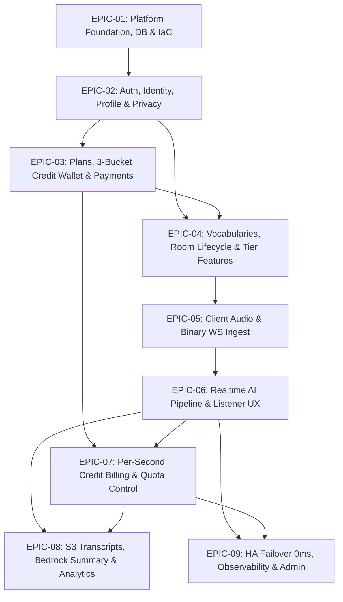

# Phân rã Epic & Sub-Epic Theo Tính năng Chính (Feature Epics & Sub-Epics Breakdown)

- **Mã tài liệu**: `DOC-06-EPICS`
- **Phiên bản**: `1.2` (Bổ sung phân tầng ưu tiên `P0 MVP / P1 Growth / P2 Enterprise`, Multi-Provider TTS `vi-VN`, Anti-Abuse, Grace Period/Notifications, Mic Check & Consent/GDPR)
- **Ngày cập nhật**: `2026-11-19`
- **Đồng bộ theo commit mới nhất**: `fefd1f4` (`feat(auth): implement reset password with OTP and optimize user queries`)
- **Tài liệu liên quan**:
  - [01-business-requirements-and-billing.md](file:///D:/code/ws-translation-realtime/docs/specs/01-business-requirements-and-billing.md)
  - [02-functional-specifications.md](file:///D:/code/ws-translation-realtime/docs/specs/02-functional-specifications.md)
  - [03-system-architecture-and-techstack.md](file:///D:/code/ws-translation-realtime/docs/specs/03-system-architecture-and-techstack.md)
  - [04-api-websocket-and-ui-specs.md](file:///D:/code/ws-translation-realtime/docs/specs/04-api-websocket-and-ui-specs.md)
  - [implementation-tasks-roadmap.md](file:///D:/code/ws-translation-realtime/docs/tasks/implementation-tasks-roadmap.md)

---

## 1. Tổng quan Ma trận Epic (9 Epics — 36 Sub-Epics)

Quy ước trạng thái & mức độ ưu tiên:
- **Trạng thái**: `DONE` (hoàn tất code + test + merge) | `IN_PROGRESS` (hoàn thiện một phần) | `TODO` (chưa triển khai).
- **Phân tầng phát hành (Release Priority)**:
  - **`P0 (MVP v1.0)`**: Bắt buộc để ra mắt bản thương mại đầu tiên có luồng End-to-End thu phí được.
  - **`P1 (Growth v1.1)`**: Tăng chuyển đổi & giữ chân khách (Social SSO, cả 2 cổng thanh toán, Auto Top-up, VAT PDF, AI Summary, Custom Vocabulary, Scheduled Room).
  - **`P2 (Enterprise v2.0)`**: Quy mô sự kiện lớn & vận hành chuẩn doanh nghiệp (White-label, 10 Speakers, Analytics PDF, Zero-Downtime 0ms Handover, Admin Portal đầy đủ).

| Mã Epic | Tên Epic (Feature chính) | Số Sub-Epic | Tham chiếu Specs | Trạng thái |
| :--- | :--- | :---: | :--- | :---: |
| **EPIC-01** | Nền tảng Hạ tầng, Cơ sở dữ liệu & CI/CD | 4 | `DOC-03-SAD`, `DOC-04-API-UI` | `IN_PROGRESS` (3/4 Done) |
| **EPIC-02** | Xác thực, Tài khoản, Hồ sơ & Quyền riêng tư Host | 5 | `MOD-01` (`FR-101`..`FR-105`, `FR-107`), `SCR-01` | `IN_PROGRESS` (3/5 Done) |
| **EPIC-03** | Gói Dịch vụ, Ví Credit 3 Ngăn, Thanh toán & Lịch sử | 6 | `MOD-05` (`FR-501`..`FR-503`, `FR-508`..`FR-509`), `SCR-02`, `SCR-06` | `IN_PROGRESS` |
| **EPIC-04** | Từ điển Chuyên ngành, Vòng đời Phòng & Tính năng Theo Gói | 5 | `MOD-02` (`FR-201`..`FR-208`), `FR-106`, `SCR-02` | `IN_PROGRESS` |
| **EPIC-05** | Thu âm Client & Tầng Ingest WebSocket Nhị phân | 3 | `MOD-03` (`FR-301`..`FR-302`), `SCR-03` | `IN_PROGRESS` |
| **EPIC-06** | Pipeline AI Dịch thuật Realtime & Trải nghiệm Người nghe | 5 | `MOD-03` (`FR-303`..`FR-306`), `MOD-04` (`FR-401`..`FR-405`), `SCR-03`, `SCR-04` | `TODO` |
| **EPIC-07** | Động cơ Tính cước Theo Từng Giây & Kiểm soát Cạn Credit | 3 | `MOD-05` (`FR-504`..`FR-507`) | `TODO` |
| **EPIC-08** | Biên bản Dịch thuật, AI Tóm tắt & Session Analytics | 4 | `MOD-04` (`FR-402`, `FR-406`..`FR-408`), `SCR-05` | `TODO` |
| **EPIC-09** | Độ sẵn sàng cao, Failover 0ms, Giám sát & Quản trị Hệ thống | 3 | `MOD-06` (`FR-601`..`FR-604`) | `TODO` |

---

## 2. Sơ đồ Phụ thuộc Giữa các Epic (Execution Dependency Graph)

---

## 3. Chi tiết Từng Epic & Sub-Epic

---

### EPIC-01: Nền tảng Hạ tầng, Cơ sở dữ liệu & CI/CD (Platform Foundation, DB & IaC)

- **Mục tiêu**: Xây dựng bộ khung Monorepo (`apps/web`, `apps/backend`), Clean Architecture trên FastAPI, lược đồ PostgreSQL 16 (10 bảng + Alembic), Terraform đa môi trường và CI/CD tự động.
- **Trạng thái tổng thể**: `IN_PROGRESS` (Core BE/FE/DB/CI đã xong; còn pipeline CD push ECR & Rolling Deploy ECS).

| Mã Sub-Epic | Tên Sub-Epic | Ưu tiên | Scope & Deliverables chính | Tasks liên quan | Trạng thái |
| :--- | :--- | :---: | :--- | :--- | :---: |
| **EP01-S1** | Backend Core & Clean Architecture | `P0` | FastAPI factory (`app/main.py`), Pydantic Settings (`core/config.py`), RFC 7807 exception handlers (`core/exceptions.py`), Security/JWT helpers (`core/security.py`), `GET /api/v1/health`. | Nền tảng BE | `DONE` |
| **EP01-S2** | PostgreSQL 16 Schema & Repositories | `P0` | 10 ORM models, Alembic migration `0001_initial_schema`, Async Repository layer (`UserRepository`, `WalletRepository`, `RoomRepository`). | `TASK-DB-01..03` | `DONE` |
| **EP01-S3** | Frontend Next.js 15 Foundation | `P0` | Next.js 15 App Router (`output: "standalone"`), TailwindCSS, API Client (`lib/api-client.ts`, `lib/api-base.ts`), Vitest + Testing Library setup. | Nền tảng FE | `DONE` |
| **EP01-S4** | Terraform IaC & GitHub Actions CI/CD | `P0` | Terraform modules (`vpc`, `alb`, `ecs`, `ecr`, `rds`, `elasticache`, `cognito`, `appsync`, `s3_cloudfront`, `iam`, `security`, `waf`, `dev_box_ec2`) cho `local`/`dev`/`prod`; CI workflows (`backend-ci`, `frontend-ci`, `infra-ci`, `pr-check`). **Còn lại**: CD push ECR & ECS Deploy (OIDC). | Hạ tầng & CI/CD | `IN_PROGRESS` |

---

### EPIC-02: Xác thực, Tài khoản, Hồ sơ & Quyền riêng tư Host (Authentication, Identity, Profile & Privacy)

- **Mục tiêu**: Hoàn thiện vòng đời tài khoản Host tích hợp Amazon Cognito (đăng ký + Anti-Abuse, OTP, đăng nhập, silent refresh bằng HttpOnly cookie, logout, quên/đặt lại mật khẩu, Social SSO), quản lý hồ sơ cá nhân/VAT và tuân thủ GDPR/PDPA.
- **Tham chiếu**: `MOD-01` (`FR-101`..`FR-105`, `FR-107`), `SCR-01`, `SCR-02.1`.

| Mã Sub-Epic | Tên Sub-Epic | Ưu tiên | Scope & Deliverables chính | Tasks liên quan | Trạng thái |
| :--- | :--- | :---: | :--- | :--- | :---: |
| **EP02-S1** | Đăng ký Host, Xác thực OTP & Welcome Bonus | `P0` | `POST /auth/register` (chống enumeration + **bổ sung Anti-abuse block disposable email & IP rate-limit**), `POST /auth/confirm` (ACID khởi tạo `users`, `user_profiles`, `subscriptions` `FREE`, `wallets` tặng `200 Cr` Promo 30 ngày), `POST /auth/resend-otp`, UI `/register` & `/verify-otp`. | `TASK-AUTH-01..03`, `TASK-UI-01` | `DONE` *(Anti-abuse bổ sung ở `EP03-S0`)* |
| **EP02-S2** | Đăng nhập, Silent Refresh & Logout/Revoke | `P0` | `POST /auth/login` (HttpOnly cookie `ws_refresh_token` & `ws_remember_me`), `POST /auth/refresh` (cookie-only), `POST /auth/logout` (`204`, `globalSignOut` + Redis Blocklist), Cognito JWKS RS256, UI `/login`. | `TASK-AUTH-04, 07, 08`, `TASK-UI-02` | `DONE` |
| **EP02-S3** | Quên mật khẩu & Đặt lại mật khẩu (OTP) | `P0` | `POST /auth/forgot-password` (anti-enumeration, 3 lần/15p), `POST /auth/reset-password` (5 lần sai OTP, `GlobalSignOut`), UI `/forgot-password` & `/reset-password`. | `TASK-AUTH-09..10`, `TASK-UI-03` | `DONE` |
| **EP02-S4** | Đăng nhập Social SSO (Google & Apple) | `P1` | Cognito Hosted UI / OAuth2 callback cho Google & Apple SSO, xử lý `privaterelay.appleid.com`, khởi tạo `FREE` + `200 Cr` Welcome Bonus cho user SSO mới, nối `SocialSsoButtons`. | `TASK-AUTH-05..06` | `TODO` |
| **EP02-S5** | Hồ sơ Cá nhân, VAT, Avatar S3, Đổi mật khẩu & Xóa tài khoản (`FR-107`) | `P0` *(Profile)* / `P1` *(VAT/GDPR)* | `GET /users/me` (trả profile + `entitlements` + 3 ngăn Credit), `PATCH /users/me/{profile,preferences}`, `PUT /users/me/billing-info`, `POST /users/me/avatar/{upload-url,confirm}`, `POST /users/me/change-password`, `DELETE /users/me` (GDPR); trang `/dashboard/profile`. | `TASK-AUTH-11`, `TASK-PROF-01..06`, `TASK-UI-04` | `TODO` |

---

### EPIC-03: Gói Dịch vụ, Ví Credit 3 Ngăn, Thanh toán & Lịch sử (Plans, Subscriptions, Credit Wallet & Payments)

- **Mục tiêu**: Triển khai 4 gói Subscription cố định (`FREE`/`PRO`/`BUSINESS`/`ENTERPRISE`), `EntitlementGuard` cache Redis, ví Credit 3 ngăn (`Promo -> Plan -> Top-up`, `1 USD = 100 Credits`), 3 gói Top-up lẻ cố định (`PACK_S/M/L`), Grace Period 3 ngày, SES Notification Matrix, Auto Top-up, Promo Code và 2 sổ Lịch sử Nạp tiền + Lịch sử Sử dụng.
- **Tham chiếu**: `MOD-05` (`FR-501`..`FR-503`, `FR-508`, `FR-509`), `SCR-02`, `SCR-06`.

| Mã Sub-Epic | Tên Sub-Epic | Ưu tiên | Scope & Deliverables chính | Tasks liên quan | Trạng thái |
| :--- | :--- | :---: | :--- | :--- | :---: |
| **EP03-S0** | Schema 4 Gói, Subscription, Credit Packs, `EntitlementGuard` & Cron Sweep | `P0` | Migration `0002_credit_plans_and_ledger` (`plans`, `subscriptions`, `credit_packs`, `credit_ledger`, nâng cấp `wallets` 3 ngăn); seed 4 gói (`$0`/`$19`/`$59`/`$199`) + 3 packs (`$10`/`$30`/`$100`); `EntitlementGuard` cache Redis; APIs `GET /plans`, `GET /credit-packs`, `GET/POST /subscriptions/*`; Cron sweep hết hạn + Grace Period 3 ngày + SES Notification Worker (8 sự kiện) + Anti-abuse blocklist cho `FREE`. | `TASK-PLAN-01..04` (`FR-501`, `FR-509`) | `TODO` |
| **EP03-S1** | Ví Credit 3 Ngăn & Cài đặt Tiết kiệm | `P0` | REST API `GET /api/v1/wallets/me` (`promoCredits`, `planCredits`, `topupCredits`, `totalCredits`, hạn dùng), `PATCH /api/v1/wallets/me/settings` (`autoDegradeTts`); nối `WalletCard` 3 ngăn trên `/dashboard`. | `TASK-WAL-01..02` | `IN_PROGRESS` |
| **EP03-S2** | Thanh toán Quốc tế qua Stripe (Subscription + Top-up Pack) | `P1` *(hoặc `P0` nếu mở thị trường Global trước)* | `POST /subscriptions/checkout` & `POST /wallets/topup` (`PACK_S/M/L` + `% Bonus` theo gói), Webhook Stripe idempotent (`FOR UPDATE`, kích hoạt chu kỳ 30 ngày / xử lý `PAST_DUE` / cộng `topup_credits` + đồng bộ Redis). | `TASK-PAY-01..02` | `TODO` |
| **EP03-S3** | Thanh toán Nội địa qua VietQR Động & Webhook IPN | `P0` *(thị trường VN)* | Sinh mã VietQR EMVCo cố định cho gói Subscription 30 ngày & Top-up Pack, Webhook SePay/Casso verify HMAC + regex `TR\d{6}` -> kích hoạt gói / cộng `topup_credits` + `PAYMENT_CONFIRMED` + gửi nhắc gia hạn T-7/T-3/T-1. | `TASK-PAY-03..04` | `TODO` |
| **EP03-S4** | Thẻ đã lưu (PCI-DSS) & Tự động Nạp gói Credit (`Auto Top-up`) | `P1` | APIs Stripe SetupIntent (chỉ `BUSINESS+`), `PUT /wallets/auto-topup` (`thresholdCredits`, `packCode`), background job Stripe Off-session Charge kèm Redis lock `lock:auto_topup:{hostId}`. | `TASK-WAL-03..04`, `TASK-PAY-05` | `TODO` |
| **EP03-S5** | Lịch sử Nạp tiền, Lịch sử Sử dụng, Promo Code & UI 4 Tab (`SCR-06`) | `P0` *(Lịch sử + Promo)* / `P1` *(PDF VAT)* | APIs `GET /wallets/me/topup-history`, `GET /wallets/me/usage-history` (`credit_ledger`), `GET /wallets/me/sessions/{roomId}/breakdown` (chi tiết từng giây + CSV), `GET /wallets/transactions/{txId}/receipt` (PDF VAT `BUSINESS+`), `POST /wallets/promo-redeem`; trang `/dashboard/billing` 4 tab. | `TASK-WAL-05..07`, `TASK-PAY-06`, `TASK-UI-11` | `IN_PROGRESS` |

---

### EPIC-04: Từ điển Chuyên ngành, Vòng đời Phòng & Tính năng Theo Gói (Vocabularies, Room Lifecycle & Tier Features)

- **Mục tiêu**: Quản lý bộ từ điển thuật ngữ chuyên ngành đồng bộ AWS, toàn bộ vòng đời phòng dịch (`1-on-1` & `Broadcast`), Mic Check Lobby, kiểm tra `EntitlementGuard` + `maxConcurrentRooms`, cấp Ephemeral JWT cho Guest Listener và các tính năng nhỏ mở rộng theo gói.
- **Tham chiếu**: `MOD-02` (`FR-201`..`FR-208`), `FR-106`, `SCR-02`.

| Mã Sub-Epic | Tên Sub-Epic | Ưu tiên | Scope & Deliverables chính | Tasks liên quan | Trạng thái |
| :--- | :--- | :---: | :--- | :--- | :---: |
| **EP04-S1** | CRUD Bộ Từ điển Chuyên ngành & Đồng bộ AWS | `P1` | APIs `/api/v1/vocabularies` (CRUD + Import CSV/TXT kiểm tra hạn mức gói `PRO`: 2×50, `BUSINESS`: 10×256, `ENTERPRISE`: không giới hạn); Background sync lên Amazon Transcribe & Amazon Translate. | `TASK-VOC-01..08` | `TODO` |
| **EP04-S2** | Tạo Phòng, Entitlement/Balance Check, Mic Check Lobby & QR | `P0` | Kiểm tra `EntitlementGuard` (`allowedRoomModes`, `maxTargetLangs`, `maxConcurrentRooms`) + `total_credits >= 10 phút` (`402`, cảnh báo x2 luồng ở `1-on-1`); tạo phòng `IDLE` (Mic Check Lobby `0 Cr`), APIs `POST/GET /rooms`, `GET /rooms/{id}/qr`; nối `/dashboard` + Modal Tạo phòng + Modal QR. | `TASK-ROOM-01..04, 12`, `TASK-UI-05..06, 08` | `IN_PROGRESS` |
| **EP04-S3** | Guest Listener Join, Ephemeral Auth & Presence | `P0` | Public API `GET /rooms/check/{roomCode}`, `POST /rooms/join` (check passcode, kiểm tra `maxListeners` theo gói, ký Ephemeral JWT 4h chỉ Subscribe AppSync), `POST /rooms/{id}/heartbeat` (TTL 45s tự dọn sĩ số & `tts_count`). | `TASK-ROOM-05..06, 13` | `TODO` |
| **EP04-S4** | Điều khiển Nóng Phiên Dịch (Hot-Config & State Machine) | `P0` | APIs `PATCH /rooms/{id}/languages` (check `maxTargetLangs`), `PATCH /rooms/{id}/permissions`, `POST /rooms/{id}/state` (`START`/`PAUSE`/`RESUME`/`END_ROOM`, giới hạn 15 phút cho gói `FREE`) & định tuyến song công `1-on-1`. | `TASK-ROOM-07..11` | `TODO` |
| **EP04-S5** | Tính năng Mở rộng Theo Gói (`Scheduled`, `Multi-Speaker`, `Branding`, `Voice`, `Profanity`) | `P1` *(Scheduled, Profanity, Voice)* / `P2` *(Multi-Speaker, White-label)* | Lên lịch phòng trước (`PRO+`), lọc từ nhạy cảm (`PRO+`), chọn giọng TTS Nam/Nữ (`BUSINESS+`), phân quyền nhiều Diễn giả (`BUSINESS` 3 / `ENTERPRISE` 10), Custom Logo/Màu & White-label phòng nghe (`BUSINESS+`). | `TASK-ROOM-14..15` (`FR-207`, `FR-208`) | `TODO` |

---

### EPIC-05: Thu âm Client & Tầng Ingest WebSocket Nhị phân (Client Audio Capture & Binary WebSocket Ingest)

- **Mục tiêu**: Xây dựng đường truyền âm thanh độ trễ thấp từ trình duyệt Speaker lên FastAPI Backend theo giao thức nhị phân 16-byte (`>IQBBH`), tích hợp VAD cắt khoảng lặng, bộ đệm vòng tròn 2 phía (5s Client / 10s Redis) và ACK 500ms.
- **Tham chiếu**: `MOD-03` (`FR-301`..`FR-302`).

| Mã Sub-Epic | Tên Sub-Epic | Ưu tiên | Scope & Deliverables chính | Tasks liên quan | Trạng thái |
| :--- | :--- | :---: | :--- | :--- | :---: |
| **EP05-S1** | Giao thức Khung Âm thanh Nhị phân 16-byte (`>IQBBH`) | `P0` | Hoàn thiện bộ đóng gói/giải mã khớp từng byte giữa Python (`app/schemas/ws_protocol.py` — đã có) và TypeScript `DataView` (`apps/web/src/lib/audio-protocol.ts`), kèm unit test cross-protocol. | `TASK-AUD-03` | `IN_PROGRESS` |
| **EP05-S2** | Browser AudioWorklet, Silero VAD & Local Ring Buffer 5s | `P0` | Module `AudioWorkletProcessor` lấy mẫu/downsample PCM 16kHz 16-bit Mono `100ms/frame`, tích hợp `@ricky0123/vad-web` gắn cờ `is_speech`, Client Local Ring Buffer 50 frames (5s) tự cắt tỉa theo `lastCommittedSeq`. | `TASK-AUD-01..02, 04` | `TODO` |
| **EP05-S3** | FastAPI WebSocket Ingest, Redis Stream 10s & ACK Loop | `P0` | Endpoint `WS /ws/v1/rooms/{roomId}/ingest`, xác thực Host/Speaker, ghi đệm Redis Stream `room:{id}:audio_buffer` (`MAXLEN ~ 100`, `< 2ms`), vòng lặp `STREAM_ACK` mỗi 500ms và cơ chế tự động `PAUSED` khi im lặng liên tục 15 phút. | `TASK-AUD-05..08` | `TODO` |

---

### EPIC-06: Pipeline AI Dịch thuật Realtime & Trải nghiệm Người nghe (Realtime AI Translation Pipeline & Listener Experience)

- **Mục tiêu**: Vận hành chuỗi AI bất đồng bộ `Transcribe Streaming -> Translate (Song song N ngôn ngữ) -> Multi-Provider Neural TTS (Polly + Fallback vi-VN) -> AppSync Events Fan-out` đạt SLA (`Partial < 500ms`, `Final < 800ms`, `TTS < 1.2s`) cùng `SCR-03` & `SCR-04`.
- **Tham chiếu**: `MOD-03` (`FR-303`..`FR-306`), `MOD-04` (`FR-401`..`FR-405`), `SCR-03`, `SCR-04`.

| Mã Sub-Epic | Tên Sub-Epic | Ưu tiên | Scope & Deliverables chính | Tasks liên quan | Trạng thái |
| :--- | :--- | :---: | :--- | :--- | :---: |
| **EP06-S1** | Streaming STT qua Amazon Transcribe (HTTP/2) | `P0` | Integration `integrations/transcribe.py` (native `asyncio` + offline mock), bơm frame `vad_flag=1`, gắn `VocabularyFilterMethod` nếu bật Profanity Filter, tách `Partial` (`< 350ms`) vs `Final` kèm `seqStart`/`seqEnd`/`startTimeMs`/`endTimeMs`. | `TASK-AI-01..02` | `TODO` |
| **EP06-S2** | Parallel N-Language MT & Partial Debounce 300ms | `P0` | Integration `integrations/translate.py` (`aioboto3` + offline mock), Debounce `300ms` (hoặc $\ge 3$ từ mới) cho `Partial`, `asyncio.gather` dịch song song tối đa 10 ngôn ngữ `< 150ms`, gắn Custom Terminology nếu có. | `TASK-AI-03..04` | `TODO` |
| **EP06-S3** | Smart Demand-Driven Multi-Provider TTS (`Polly` + `Azure Speech vi-VN`) | `P0` | `TTSProviderAdapter` (`integrations/tts.py`): kiểm tra `entitlements.allowTts` & `HGET room:{id}:tts_count {lang} > 0`; gọi Amazon Polly Neural (primary) và **Azure AI Speech Neural (`southeastasia`, REST via `httpx.AsyncClient`)** cho `vi-VN` (`HoaiMyNeural`/`NamMinhNeural`), `th-TH`, `id-ID` (tự hạ `Text-only` + `0 Cr` khi lỗi); upload `.mp3` lên S3 (24h) + CloudFront `< 400ms`; API `POST /rooms/{id}/tts-toggle`. | `TASK-AI-05..06, 10` | `TODO` |
| **EP06-S4** | Commit Segment, Live Buffer & AppSync Fan-out | `P0` | Cập nhật `last_committed_seq` + trim Redis audio buffer, `RPUSH room:{id}:live_transcripts`, publish `SUBTITLE_SEGMENT` lên AppSync Events kênh `rooms/{id}/lang/{code}` (`< 50ms` cho 1.000 người). | `TASK-AI-07..09` | `TODO` |
| **EP06-S5** | Host Studio (`SCR-03`), Listener View (`SCR-04`) & Adaptive Audio Queue | `P0` | Trang `/rooms/[roomId]/host` (Mic Check Lobby, Waveform 60fps, đèn VAD, đồng hồ Credit từng giây, phụ đề live, nút Start/Pause/End); trang mobile-first `/r/[roomCode]` (Banner AI Consent `FR-107`, Floating Bar đổi ngôn ngữ `< 200ms`, nút Loa TTS, Đơn ngữ/Song ngữ, Smart Auto-scroll) + `AdaptiveAudioQueue` (`1.15x`–`1.25x`). | `TASK-AI-11`, `TASK-UI-07, 09` | `TODO` |

---

### EPIC-07: Động cơ Tính cước Theo Từng Giây & Kiểm soát Cạn Credit (Per-Second Credit Billing & Quota Control)

- **Mục tiêu**: Triển khai cơ chế tính cước công bằng theo từng giây sử dụng thực tế (không làm tròn block 10s), trừ nguyên tử theo thứ tự 3 ngăn `Promo -> Plan -> Top-up` hỗ trợ nhiều phòng chạy song song, loại trừ 100% lỗi AI `5xx`, cùng 3 ngưỡng bảo vệ Host.
- **Tham chiếu**: `MOD-05` (`FR-504`..`FR-507`), `DOC-01-BRD` Mục 5.

| Mã Sub-Epic | Tên Sub-Epic | Ưu tiên | Scope & Deliverables chính | Tasks liên quan | Trạng thái |
| :--- | :--- | :---: | :--- | :--- | :---: |
| **EP07-S1** | Bộ đo đếm Lưu lượng Từng Giây (`1s Redis`) & Công thức Credit | `P0` | Vòng lặp 1 giây đo chính xác `audio_seconds` (bước `0.1s`, tính cả 2 luồng ở `1-on-1`), `listener_seconds` (tổng người-giây), `mt_chars`, `tts_chars`; loại trừ 100% lỗi AI `5xx`; quy đổi ra Credits (`5.5 / 3.5 / 4.0 / 0.5 Cr`). | `TASK-MET-01..02` | `TODO` |
| **EP07-S2** | Khấu trừ 3 Ngăn Nguyên tử (`15s` / Event ACID Flush) & `BILLING_TICK` | `P0` | Trừ realtime mỗi 1s trên Redis `wallet:{hostId}:credits` (Lua script an toàn khi nhiều phòng chạy song song) + phát `BILLING_TICK`; flush ACID xuống PostgreSQL (`wallets` theo thứ tự `Promo -> Plan -> Top-up` + `usage_ledger`) mỗi 15s và ngay khi `PAUSE`/`END_ROOM`; tổng hợp 1 dòng vào `credit_ledger` khi kết thúc phòng. | `TASK-MET-03..04` | `TODO` |
| **EP07-S3** | Cảnh báo Cạn Credit, Hạ cấp mềm TTS & Đóng phòng An toàn | `P0` | Xử lý 3 ngưỡng chính xác tới từng giây: `< 5 phút` (`LOW_BALANCE_WARNING` + Popup mua nhanh `PACK_S/M/L`), `< 1 phút` (`GRACEFUL_DEGRADATION` tắt TTS nếu gói cho phép), `= 0 Cr` (`QUOTA_EXHAUSTED` chốt câu cuối, flush giây lẻ và đóng phòng). | `TASK-MET-05..07` | `TODO` |

---

### EPIC-08: Biên bản Dịch thuật, AI Tóm tắt & Session Analytics (Transcripts Export, Bedrock Summary & Analytics)

- **Mục tiêu**: Đồng bộ lịch sử khi F5/vào muộn, tự động đóng gói biên bản đa định dạng lên S3 theo retention từng gói (`7/30/90/365 ngày` + 14 ngày ân hạn khi hạ gói), quyền xóa biên bản GDPR, tạo tóm tắt AI đa ngôn ngữ qua Bedrock (`0 Cr` cache) và thống kê phân tích phiên.
- **Tham chiếu**: `MOD-04` (`FR-402`, `FR-406`..`FR-408`), `FR-107`, `SCR-05`.

| Mã Sub-Epic | Tên Sub-Epic | Ưu tiên | Scope & Deliverables chính | Tasks liên quan | Trạng thái |
| :--- | :--- | :---: | :--- | :--- | :---: |
| **EP08-S1** | Đồng bộ Lịch sử Phụ đề Trực tiếp & Sau phiên | `P0` | `GET /api/v1/rooms/{id}/transcripts?lang=&afterSeq=&limit=` đọc từ Redis `live_transcripts` (khi ACTIVE) hoặc S3 `master.json` (khi ENDED), ghép nối mượt không trùng câu. | `TASK-TRN-01` | `TODO` |
| **EP08-S2** | S3 Transcript Compiler Worker, Export Pre-signed URL & Xóa GDPR | `P0` *(txt/srt)* / `P1` *(vtt/csv/GDPR)* | Background worker `workers/export_task.py` xuất `master.json`, `.txt`/`.md`, `.srt`, `.vtt`, `.csv` (UTF-8 BOM) lên S3 kèm `room_transcripts.expires_at` theo gói; API `GET /rooms/{id}/transcripts/export` kiểm tra `exportFormats` & `allowListenerDownload`; `DELETE /rooms/{id}/transcripts` (GDPR). | `TASK-TRN-02..06` | `TODO` |
| **EP08-S3** | On-Demand AI Meeting Summary (Amazon Bedrock) & Cache `0 Cr` | `P1` | Integration `integrations/bedrock.py`, `POST /rooms/{id}/summary` (check `aiSummaryLevel`: `PRO` `15 Cr` / `BUSINESS+` `25 Cr`, trả cache `0 Cr` nếu `READY`, ghi `credit_ledger`, gửi SES notification), `GET /rooms/{id}/summary`. | `TASK-TRN-07..10` | `TODO` |
| **EP08-S4** | Màn hình Lịch sử Dịch, Tóm tắt AI & Session Analytics (`SCR-05`) | `P1` *(Transcript/Summary)* / `P2` *(Analytics PDF)* | Trang `/dashboard/rooms/[roomId]/history` 3 tab: Full Transcript (tìm kiếm, đổi ngôn ngữ, tải theo gói, xóa GDPR), AI Summary (nhảy mốc `[mm:ss]`), và Session Analytics & Credit Breakdown (`GET /rooms/{id}/analytics`, xuất CSV `BUSINESS+` / PDF `ENTERPRISE`). | `TASK-UI-10`, `FR-408` | `TODO` |

---

### EPIC-09: Độ sẵn sàng cao, Failover 0ms, Giám sát & Quản trị Hệ thống (HA, Failover, Observability & Admin Portal)

- **Mục tiêu**: Vận hành Production chuẩn doanh nghiệp: chuyển đổi container không rớt từ khi deploy hoặc crash, giám sát độ trễ P95/biên lợi nhuận trên CloudWatch và bộ API quản trị cho System Admin.
- **Tham chiếu**: `MOD-06` (`FR-601`..`FR-604`).

| Mã Sub-Epic | Tên Sub-Epic | Ưu tiên | Scope & Deliverables chính | Tasks liên quan | Trạng thái |
| :--- | :--- | :---: | :--- | :--- | :---: |
| **EP09-S1** | Zero-Downtime `SIGTERM` Handover & Crash Replay Failover | `P2` | Xử lý `SIGTERM` (`DRAINING` -> đợi `isFinal` -> `PREPARE_HANDOVER` -> Make-Before-Break 0ms); Crash Replay Failover `< 500ms` (Client mất ACK 300ms -> reconnect -> Container mới đọc `last_committed_seq` + replay Redis Stream & Client Ring Buffer 5s). | `TASK-OPS-01..02` | `TODO` |
| **EP09-S2** | Deep Health Check & CloudWatch Observability | `P1` *(Health)* / `P2` *(Alarms)* | Nâng cấp `GET /api/v1/health` kiểm tra sâu PostgreSQL (`SELECT 1`) + Redis (`PING < 5ms`, trả `503` khi lỗi); CloudWatch Custom Metrics (`ActiveRoomsCount`, `Stt/Mt/Tts/E2E Latency P95`, `BillingDeductionErrorsCount`) + Alarm `E2E P95 > 1500ms` bắn SNS/Slack. | `TASK-OPS-03..04` | `TODO` |
| **EP09-S3** | System Admin Portal APIs (Plans, Pricing, Promo, Refund & Stats) | `P2` | Admin APIs (RBAC `role == ADMIN`): `GET/PUT /admin/pricing` & `/admin/plans`, CRUD `/admin/promos`, `POST /admin/wallets/{hostId}/adjust` (Audit Log), `POST /admin/transactions/{txId}/refund`, `GET /admin/stats/overview` (Doanh thu Credit vs AWS COGS & Gross Margin). | `TASK-OPS-05..08`, `TASK-PAY-07` | `TODO` |

---

## 4. Lộ trình Phát hành theo 3 Phiên bản (Release Milestones)

1. **Release `v1.0` — MVP Commercial Launch (`P0`)**:
   - Auth Email/OTP (`DONE`) + Profile cơ bản (`EP02-S5`)
   - 4 gói & `EntitlementGuard` (`EP03-S0`) + Ví Credit 3 ngăn (`EP03-S1`) + VietQR (`EP03-S3`) + Lịch sử Nạp/Sử dụng (`EP03-S5`)
   - Room Lifecycle, Mic Check Lobby & Guest Join (`EP04-S2..S4`) + AudioWorklet/WS Ingest (`EP05-S1..S3`)
   - Realtime AI Pipeline + Multi-Provider TTS `vi-VN` + Host Studio + Listener View (`EP06-S1..S5`)
   - Per-Second Credit Billing & Quota Control (`EP07-S1..S3`) + Live Sync & Export `.txt`/`.srt` (`EP08-S1..S2`) + CD (`EP01-S4`).
2. **Release `v1.1` — Growth & Retention (`P1`)**:
   - Stripe Subscription/Top-up (`EP03-S2`), Auto Top-up (`EP03-S4`), VAT Invoice PDF (`EP03-S5`), Social SSO (`EP02-S4`), GDPR Delete (`EP02-S5`/`EP08-S2`), Custom Vocabularies (`EP04-S1`), Scheduled Rooms + Profanity Filter + TTS Voice Selection (`EP04-S5`), Bedrock AI Summary (`EP08-S3..S4`), Deep Health Check (`EP09-S2`).
3. **Release `v2.0` — Enterprise Scale (`P2`)**:
   - Multi-Speaker Co-Host & White-label Branding (`EP04-S5`), Session Analytics PDF (`EP08-S4`), Zero-Downtime 0ms `SIGTERM` Handover & Crash Replay (`EP09-S1`), CloudWatch Alarms (`EP09-S2`), System Admin Portal (`EP09-S3`).
